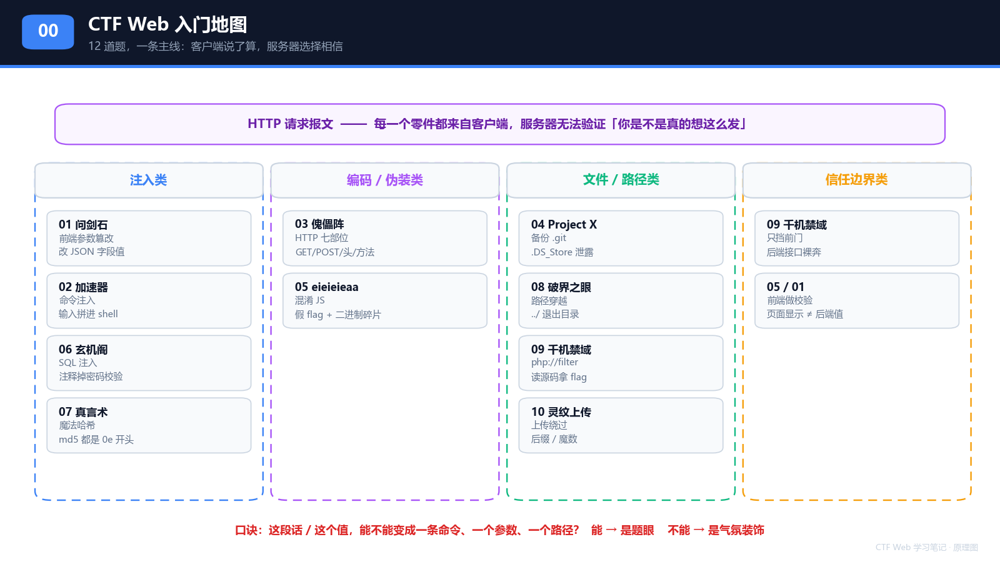
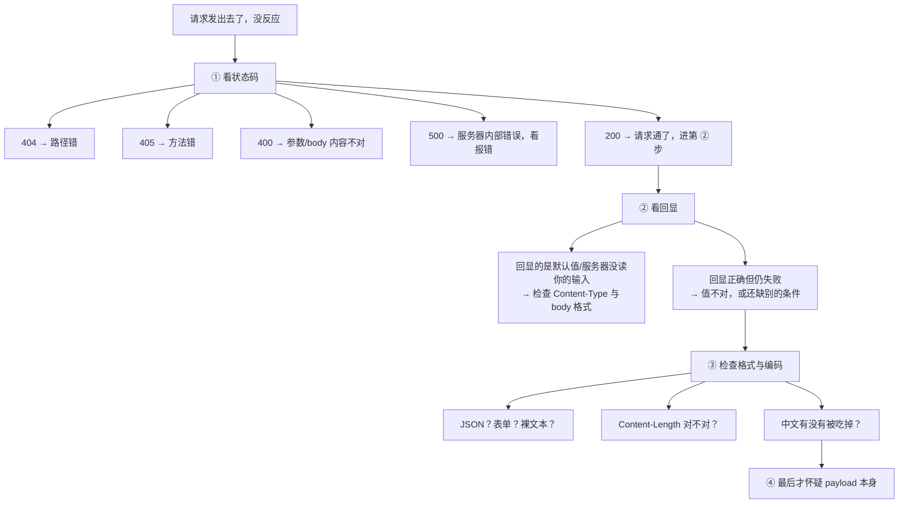

> **CTF Web 学习笔记**（共 19 篇）　[📖 系列总览](/posts/ctf-learning/00-overview/)　·　[01 问剑石 →](/posts/ctf-learning/01-wenjianshi/)

> 这份笔记整理了 11 道 Web 靶场的完整解题思路。它们**看起来毫不相干**（修仙、游戏加速器、傀儡阵、项目管理、猎奇音频、上传法阵、站内搜索），但本质是同一条主线：**HTTP 请求的每一块都是客户端说了算的，服务器只能"选择相信"哪几块。**

---

## 一、这份笔记怎么用

| 你的状态 | 建议路径 |
|---|---|
| 完全没碰过 CTF | 先读本篇的「主线」和「通用排查口诀」，再按 01→11 顺序读 |
| 卡在某道题上 | 直接跳到对应篇章，先看「② 思路图」，再看「③ 动手步骤」 |
| 想复习/查命令 | 直接看 99 工具箱（已按主题拆成 6 个子页），或每篇的「③ 动手步骤」 |
| 想自己练 | 每篇的「⑤ 延伸与防御」里有 DVWA / pikachu 的对应模块 |

---

## 二、主线：一张图看懂这 11 道题在考什么

```mermaid
flowchart TD
    A["HTTP 请求报文"] --> B["① 请求行"]
    A --> C["② 请求头 Headers"]
    A --> D["③ 请求体 Body"]

    B --> B1["方法 GET / POST / PUT<br/>→ 03 第七关"]
    B --> B2["路径 /query<br/>→ 03 第一关"]

    C --> C1["X-Forwarded-For<br/>→ 03 第三关"]
    C --> C2["User-Agent<br/>→ 03 第四关"]
    C --> C3["Cookie<br/>→ 03 第五关"]
    C --> C4["Referer<br/>→ 03 第六关"]

    D --> D1["JSON 格式<br/>→ 01 问剑石"]
    D --> D2["表单格式<br/>→ 02 加速器 / 03 第二关"]
    D --> D3["裸文本<br/>→ 03 第七关"]

    A --> E["服务器之间的信任边界"]
    E --> E1["命令拼接 → 02 命令注入"]
    E --> E2["文件当资产 → 04 备份/git/.DS_Store 泄露"]
    E --> E3["前端做校验 → 01 / 05"]

    A --> F["服务器把输入拿去拼接 / 比较"]
    F --> F1["拼进 SQL 语句<br/>→ 06 注释掉密码校验"]
    F --> F2["拼进文件路径<br/>→ 08 ../ 穿越 / 09 php://filter 读源码"]
    F --> F3["拿去比较（md5）<br/>→ 07 魔法哈希 0e 碰撞"]
    F --> F4["拿去当上传校验<br/>→ 10 后缀 / 魔数 三张牌"]
    F --> F5["拿去当模板编译<br/>→ 11 SSTI 从算式到读文件"]
```

---

## 三、靶场索引

| # | 靶场 | 一句话考点 | 核心技术 | 难度 |
|---|---|---|---|---|
| 01 | 问剑石·天赋测试 | 页面显示的**中文**不是后端校验的**值** | 前端参数篡改、JSON 格式 | ★ |
| 02 | D-Accelerator | ping 参数被拼进 shell 命令 | **命令注入 → RCE** | ★★ |
| 03 | 七绝傀儡阵 | 七道禁制，正好对应请求的七个部位 | HTTP 报文全解剖 | ★★ |
| 04 | Project X | 开发习惯留下的三种文件泄露 | 备份泄露 / **git 历史泄露** / `.DS_Store` | ★★★ |
| 05 | eieieieaa | 混淆 JS 往 DOM 里塞假 flag 和二进制碎片 | 代码反混淆、二进制解码 | ★★★★ |
| 06 | 玄机阁·九重天衍禁制 | **报错被关掉时**怎么判断注入是否存在 | SQL 注入 · 登录绕过 | ★★ |
| 07 | 玄机阁·天衍真言术 | 两个不同的值，md5 却"相等" | **MD5 魔法哈希**、PHP 类型戏法 | ★★ |
| 08 | 破界之眼（任意文件读取） | 输入文件名的地方能不能用 `../` 退出去 | 路径穿越 · 任意文件读取 | ★ |
| 09 | 千机禁域 | 门禁只装在首页，后端接口裸奔 | 参数枚举 · **只挡前门** · `php://filter` 读源码 | ★★★ |
| 10 | 灵纹上传·通幽关 | 服务器到底在查什么？**后缀 / 魔数 / .htaccess 三张牌** | 文件上传绕过 → RCE | ★★ |
| 11 | 站内搜索 | 输入被拼进模板，就成了服务器上的代码 | **SSTI → RCE** | ★★★ |

---

## 四、贯穿全部 11 题的四条铁律

### 铁律 1：回显是唯一的真相来源

**你发送的内容，服务器不一定原样收到。** 每次请求都要先问一句：*回显里的东西，和我发出去的一致吗？*

| 现象 | 真实原因 |
|---|---|
| 回显 `光芒：none` | body 根本没被解析（Content-Type 错 / JSON 语法错） |
| 回显 `光芒：?????` | 客户端编码问题（中文字符在传输中被替换） |
| 回显 `declaration=??=??` | 同上，Burp 默认按 ISO-8859-1 处理中文 |

### 铁律 2：显示 ≠ 校验

页面上写的中文、UI 上的按钮、前端的提示，**都是给人看的**；后端比较的是代码里那个字符串。

- 01 题：页面显示「流云状青芒」，后端要的是 `flowing_azure_clouds`
- 05 题：页面显示一堆 `flag{...}`，真 flag 藏在一串 `e/i` 里

### 铁律 3：客户端说的全都不可信

`User-Agent`、`Cookie`、`Referer`、`X-Forwarded-For`、请求方法、请求体……**只要是客户端发的，就能被改**。服务器只要"信"了其中一个，攻击者就能伪造。

### 铁律 4：一切注入都是同一个病 —— 数据被当成了代码

这是全部 11 题里**最值得带走的一条**。凡是"把用户输入拼进某种要被执行的东西"，都会出事：

| 漏洞 | 用户的输入被错当成了 | 对应章节 |
|---|---|---|
| SQL 注入 | SQL **语句** | 06 |
| 命令注入 | Shell **命令** | 02 |
| 模板注入（SSTI） | 模板**代码** | 11 |
| XSS | HTML / JS **代码** | 05 |
| 路径穿越 | 文件路径**片段** | 08 / 09 |
| 上传绕过 | 服务端校验所信任的**文件属性** | 10 |

**判断方法只有一句话**：*我发出去的东西，服务器是把它当"内容"处理，还是当"指令"处理？*

- 当**内容** → 安全，你只能写字
- 当**指令** → 出事了，你能写代码

> 反过来说，**修复思路也是同一个**：不是去过滤掉某个特殊字符，而是**让数据的归数据、指令的归指令**。
> 黑名单永远能被绕过（09 题就是"只挡前门"的教训），**结构性隔离才是修复**。

---

## 五、通用排查口诀（卡住时按这个顺序走）

> 血泪经验：本次 11 道题里，**我实际卡住的地方基本都在第 ③ 步**（编码 / 格式 / 长度），而不是"思路不对"。
> 说明：这不是统计结论，只是这几次的真实情况，供排查时参考。

---

## 六、工具索引（详见 99 工具箱，已拆为 6 个子页）

| 工具 | 用途 | 什么场景必须用 |
|---|---|---|
| 浏览器 F12 | 看请求、改参数、看 DOM | 一切前端相关问题 |
| Burp Suite / Postman | 改任意请求头、重放 | 改 `User-Agent` / `Cookie` / `Referer` / 方法 |
| `curl.exe` | 命令行发请求 | 快速验证、写脚本 |
| Python `urllib` / `requests` | 批量爆破、自动化 | 需要试很多值时 |
| Node + jsdom | 跑混淆 JS、还原真实 DOM | 05 这类前端混淆题 |
| git | 翻历史版本 | 04 这类源码泄露题 |

---

## 七、延伸阅读

- [OWASP Top 10](https://owasp.org/www-project-top-ten/)（本笔记涉及的 A01 越权、A03 注入、A05 配置错误都在里面）
- [MoeCTF 2025 官方仓库](https://github.com/XDSEC/MoeCTF_2025) —— 01、03 两题的源码在仓库的 `challenges/Web/` 下（第三章「问剑石」、第四章「金曦破禁与七绝傀儡阵」）。
  仓库路径可能调整，若链接失效请在仓库内搜索题目名。
- [PortSwigger Web Security Academy](https://portswigger.net/web-security)（免费靶场，实验与本笔记一一对应）
