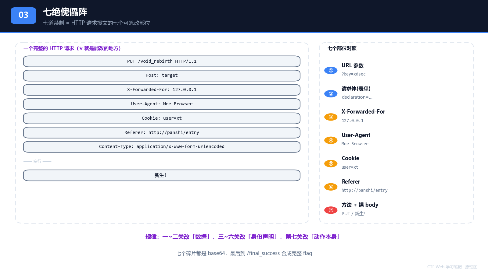
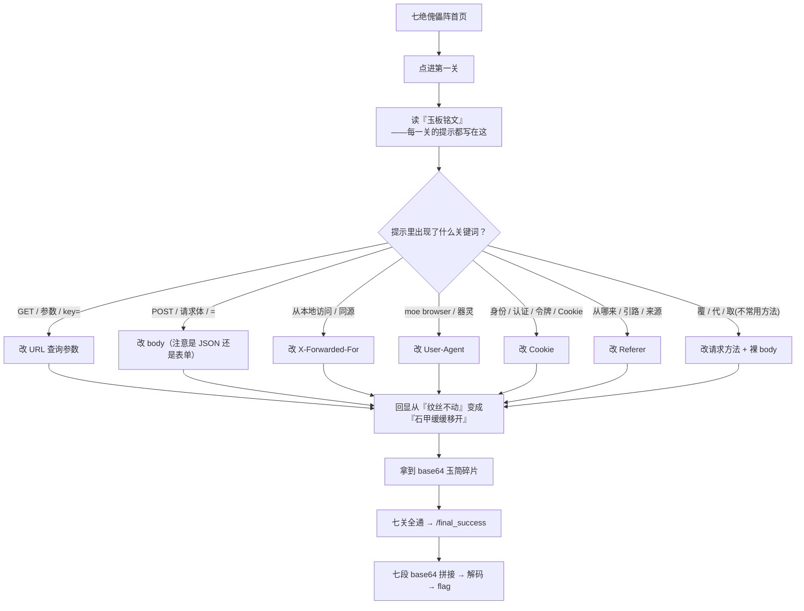

> **CTF Web 学习笔记**（共 19 篇）　[📖 系列总览](/posts/ctf-learning/00-overview/)　·　[← 02 命令注入](/posts/ctf-learning/02-command-injection/)　·　[04 Project X →](/posts/ctf-learning/04-projectx/)



> **一句话**：七道禁制，**正好对应 HTTP 请求报文的七个可篡改部位** —— 路径参数、请求体、四种请求头、请求方法。做完这一题，你就把"一个 HTTP 请求由哪些零件组成"彻底摸清了。

| 项目 | 内容 |
|---|---|
| 类型 | HTTP 协议基础 / 请求篡改（7 个关卡各考一处） |
| 难度 | ★★ |
| 前置知识 | 会用 Burp Suite 或 Postman 改请求 |
| 通关条件 | 七关各得一个 base64 碎片，最后到 `/final_success` 合成 |

---

## ① 一眼看懂

首页写着：

> 此乃玄天剑宗上古禁制，内含七尊傀儡守卫。每尊傀儡皆设有一道玄轨禁制，
> **汝需运用对玄轨真言的理解，修改请求路径、方法、敕令等，逐一破解七道禁制。**

"路径、方法、敕令" 就是在暗示你：**改的地方不一样**。每一关的页面上都有一句「玉板铭文」，那是给这一关的提示。

### 七个部位总表（这是本题的核心价值）

| 关 | 路径 | 傀儡 | 要改的部位 | 提示原文 | 正确写法 |
|---|---|---|---|---|---|
| 一 | `/stone_golem` | 磐石 | URL 查询参数 | 使用 GET 方法传递参数 `key=xdsec` | `GET /stone_golem?key=xdsec` |
| 二 | `/cloud_weaver` | 织云 | 请求体（**表单**） | 使用 POST 方法请求数据 `declaration=织云阁=第一` | POST + `Content-Type: application/x-www-form-urlencoded` |
| 三 | `/shadow_stalker` | 溯源 | 请求头 `X-Forwarded-For` | 请从本地访问这个页面 | `X-Forwarded-For: 127.0.0.1` |
| 四 | `/soul_discerner` | 器灵 | 请求头 `User-Agent` | 使用 moe browser 访问哦 | `User-Agent: Moe Browser` |
| 五 | `/heart_seal` | 心印 | 请求头 `Cookie` | 你需要以 xt 的身份认证 user | `Cookie: user=xt` |
| 六 | `/pathfinder` | 前尘 | 请求头 `Referer` | 你不是从 `http://panshi/entry` 来的吗 | `Referer: http://panshi/entry` |
| 七 | `/void_rebirth` | 逆转 | 请求方法 + **裸 body** | 使用 PUT 方法，请求体为"新生！" | `PUT` + body `新生！` |

> **规律**：一、二关改的是"数据"，三~六关改的是"身份声明"，第七关改的是"动作本身"。

---

## ② 思路图



> **判断成功没有的唯一标准**：回显里那句"傀儡的反应"变了，并且出现 `获得玉简碎片: xxxxx`。
> 失败时也有一句话（比如「磐石傀儡纹丝不动，石甲毫无反应！」）—— **失败回显和成功回显是成对设计的**，这就是最可靠的信号。

---

## ③ 动手步骤

### 第一关 `/stone_golem`｜改查询参数

```
GET /stone_golem?key=xdsec HTTP/1.1
Host: <靶机>
```

**预期**：「磐石傀儡核心光芒一闪，厚重的石甲缓缓移开！」+ 碎片

### 第二关 `/cloud_weaver`｜改请求体（表单格式）

提示直接给了：`declaration=织云阁=第一`。注意值里**含一个 `=`**，最好 URL 编码：

```
POST /cloud_weaver HTTP/1.1
Host: <靶机>
Content-Type: application/x-www-form-urlencoded
Content-Length: 60
Connection: close

declaration=%E7%BB%87%E4%BA%91%E9%98%81%3D%E7%AC%AC%E4%B8%80
```

其中：`%E7%BB%87%E4%BA%91%E9%98%81` = `织云阁`，`%3D` = `=`，`%E7%AC%AC%E4%B8%80` = `第一`。

**curl 版**（`--data-urlencode` 会自动编码）：

```powershell
curl.exe -X POST "http://<靶机>/cloud_weaver" -H "Content-Type: application/x-www-form-urlencoded" --data-urlencode "declaration=织云阁=第一"
```

> ⚠️ **两个实测过的坑**：
> 1. 值外面加引号（`declaration='织云阁=第一'`）会失败 —— 引号也变成了值的一部分
> 2. Burp Repeater 里**直接敲中文会被吃成 `?`**（Burp 内部按 ISO-8859-1 处理）→ 必须用 URL 编码，或选中中文按 `Ctrl+U`

### 第三关 `/shadow_stalker`｜改 `X-Forwarded-For`

提示「请从本地访问这个页面」。服务器一般通过 `X-Forwarded-For` 判断来源 IP：

```
GET /shadow_stalker HTTP/1.1
Host: <靶机>
X-Forwarded-For: 127.0.0.1
```

> **原理**：`X-Forwarded-For` 是给反向代理用的头，用来记录"真实客户端 IP"。但它是**客户端可以自己伪造**的 —— 服务器如果直接信它，就等于把"我是谁"的决定权交给了客户端。

### 第四关 `/soul_discerner`｜改 `User-Agent`

提示「使用 moe browser 访问哦」，铭文说「唯爱萌物，非萌灵之器拒之门外」。

```
GET /soul_discerner HTTP/1.1
Host: <靶机>
User-Agent: Moe Browser
```

**实测现象**：必须是 `Moe Browser`（**中间有一个空格**）；`MoeBrowser`（无空格）、`MoeBrowser/1.0` 都不行；大小写两种写法都能过（`moe browser` 也可以）。

> 大小写都能过、但空格必须一致，推测后端做了大小写归一化后再比较。**这属于实测现象：我手上没有该题的线上源码，具体实现未核实。**

**curl 版**（`-A` 指定 UA）：

```powershell
curl.exe -A "Moe Browser" "http://<靶机>/soul_discerner"
```

> ⚠️ **这一关不能用 F12 Console 的 `fetch`** —— `User-Agent` 属于浏览器禁止 JS 修改的头部。

### 第五关 `/heart_seal`｜改 `Cookie`

提示「以 xt 之名，攻吾之隙」+「你需要以 xt 的身份认证 user」。

```
GET /heart_seal HTTP/1.1
Host: <靶机>
Cookie: user=xt
```

**实测**：试了 80 种 cookie 名值组合，**只有 `user=xt` 通过**（`identity=xt`、`role=xt`、`token=xt`、`user=admin` 等全部失败）。

> **怎么猜到名字是 `user`**：① 提示里直接出现了 `user` 和 `xt` 两个词；② 通用套路是先试 `user`/`identity`/`role`/`name`/`token`/`auth`/`id` 这些最常见的名字。
>
> **这关的本质是「信任了未经验证的身份声明」**：服务器把「你是谁」交给客户端保管（Cookie 存在用户自己电脑里、可随意修改），于是谁都能自称别人。
>
> 正确做法有两大类：① **服务端会话**（Cookie 里只放一个不可预测的随机 ID，真实身份存在服务端）；② **签名 / 加密的令牌**（Flask 签名 session、JWT）。两者都只是让身份声明**不可伪造**，**拿到身份之后仍然必须做权限检查** —— 认证和授权是两件事。

### 第六关 `/pathfinder`｜改 `Referer`

提示「无根之木，无源之水。汝从何来？需有引路之证」+「你不是从 `http://panshi/entry` 来的吗？」

```
GET /pathfinder HTTP/1.1
Host: <靶机>
Referer: http://panshi/entry
```

**实测**：必须**一字不差**，以下全部失败：

| 值 | 结果 |
|---|---|
| `http://panshi/entry/`（多了结尾斜杠） | ❌ |
| `panshi/entry`（少了协议） | ❌ |
| `https://panshi/entry` | ❌ |
| `http://<真实靶机域名>/panshi/entry` | ❌ |

因为服务器是**字符串直接比较**（`referer == 'http://panshi/entry'`）。注意 `panshi` 这个域名**现实中不存在** —— 服务器根本不管它是否真实，只比对字符串。

**curl 版**（`-e` 指定 Referer）：

```powershell
curl.exe -e "http://panshi/entry" "http://<靶机>/pathfinder"
```

### 第七关 `/void_rebirth`｜改请求方法 + 裸 body（最难的一关）

提示「阴阳逆乱，归墟可填。以**覆**代**取**，塑吾新生」+「使用 PUT 方法，请求体为"新生！"」。

"取"=GET（获取），"覆"=PUT（覆盖/替换）。所以：

```
PUT /void_rebirth HTTP/1.1
Host: <靶机>
Content-Length: 9
Connection: close

新生！
```

**这关和第 2 关最大的区别**：**body 不是 `键=值`，也不是 JSON，就是"新生！"这三个字本身。**
因为第 2 关后端用 `request.form`（解析表单），这一关用 `request.get_data()`（**照读原始 body**）—— **服务器怎么读 body，决定你该怎么写 body。**

**实测对照表**：

| body 内容 | 结果 |
|---|---|
| `新生！`（裸的，UTF-8，**9 字节**） | ✅ 通过 |
| `%E6%96%B0%E7%94%9F%EF%BC%81`（URL 编码） | ❌ 400 |
| `x=新生！`（表单风格） | ❌ 400 |
| `{"x":"新生！"}`（JSON） | ❌ 400 |
| `新生`（少个感叹号） | ❌ 400 |
| `新生!`（**半角**感叹号，7 字节） | ❌ 400 |
| 用 POST 发 | ❌ 405 Method Not Allowed |

> **两个致命细节**：
> 1. 感叹号必须是**全角 `！`**（U+FF01，中文输入法打出来的那个）。半角 `!` 直接失败。
> 2. `Content-Length: 9` —— 是**字节数**不是字符数（3 个中文字符 = 9 字节）。

**三种发送方式**：

**① 浏览器 Console（最省事，这关不需要改任何请求头）**

```js
fetch('/void_rebirth',{method:'PUT',body:'新生！'}).then(r=>r.text()).then(t=>{document.open();document.write(t);document.close()})
```

**② Burp（用 Hex 视图，避开中文编码坑）**
方法改 `PUT`，`Content-Length: 9`，切到 **Hex** 标签把 body 字节改成：

```
E6 96 B0  E7 94 9F  EF BC 81
   新         生          ！
```

**③ curl.exe（用文件喂 body）**

```powershell
[System.IO.File]::WriteAllBytes("D:\x.txt", [byte[]](0xE6,0x96,0xB0,0xE7,0x94,0x9F,0xEF,0xBC,0x81))
curl.exe -X PUT --data-binary "@D:\x.txt" "http://<靶机>/void_rebirth"
```

### 最后：合成 flag

七关各返回一段 **base64 碎片**。访问 `/final_success` 会把它们拼起来（或在页面里给出合成入口），**拼接后 base64 解码**即得 flag：

```python
import base64
parts = ["<第1段>", "<第2段>", "<第3段>", "<第4段>",
         "<第5段>", "<第6段>", "<第7段>"]
print(base64.b64decode("".join(parts)).decode())
```

> 这也是真实 CTF 常见的设计：**flag 分片**，防止你只做对一半就拿到答案。

---

## ④ 原理拆解

（以下用 **HTTP/1.1** 的文本形式讲解。HTTP/2、HTTP/3 在线上是**二进制帧**，格式不同，但「请求行 / 请求头 / 请求体」这三层语义是一致的；另外请求体本身可以是任意二进制数据。）

HTTP 请求本质是一段按固定格式排列的字节：客户端把它发出，服务器按约定读。关键在于——**这段文本完全由发送方决定**，换成 Burp、curl 这类发包工具或一段脚本，就能造出任意内容。所以安全铁律是：**客户端传来的一切都不可信**。本题七关考的七个部位，从网址参数、表单内容到各种请求头（请求开头几行"键: 值"式的说明信息），没有一处能被服务器天然相信。

第五关把 Cookie（服务器让浏览器代存的一小段键值对，之后每次请求自动带回）直接当身份凭证：

```python
user_cookie = request.cookies.get('user', '')
if user_cookie == 'xt':
```

Cookie 存在访客自己的电脑里，改它像改记事本一样容易，这行判断形同虚设。第六关的 Referer（说明"我从哪个页面点过来"的请求头）同样是客户端自填，源码比对 `referer == 'http://panshi/entry'`，但服务器看不到你点过什么，只能看到文本里写了什么。第三关的 X-Forwarded-For（代理服务器转告访客真实 IP 的请求头）同理：程序若直接信它，谁都能自称 `127.0.0.1`。第四关 User-Agent 只是浏览器自报家门的一行字，所以后端才对这行字做了苛刻的匹配（实测必须含那个空格，`MoeBrowser` 不行）——可改的东西，比对得再严也拦不住改。

第七关改考请求方法与请求体。PUT 是 HTTP 规定的动作之一（GET 取数据、POST 交数据、PUT 整体替换，仅是约定，客户端想发哪个就发哪个）：

```python
if request.method == 'PUT':
    data = request.get_data(as_text=True)
    if data.strip() == '新生！':
```

七关各回一段 Base64 碎片（Base64 是把数据转成纯文本的可逆编码，不是加密），`/final_success` 拼接解码即得 flag（要提交的答案串）。整题翻来覆去只讲一句话：请求里每个字节都听你的，服务器只该信它自己算出来的东西。

---

## ⑤ 延伸与防御

### A. 真实世界对应

本题若用于真实系统的身份或权限判断，主要属于 **A01:2021 Broken Access Control（访问控制失效）**：服务器没能正确限制"谁能做什么"，并非注入漏洞。

CWE 是常见软件弱点的分类编号。对应 **CWE-807: Reliance on Untrusted Inputs in a Security Decision（依赖不可信输入作安全决策）**；直接用 Cookie 判断身份，还对应 **CWE-565: Reliance on Cookies without Validation and Integrity Checking（依赖未经验证及完整性检查的 Cookie）**。

经典案例：2022 年，Fortinet 的 FortiOS 等产品曝出 **CVE-2022-40684**。攻击者通过特制的 `Forwarded` 与 `User-Agent` 请求头，让管理接口误认请求来自可信来源，绕过身份验证。它与本题信任请求头的问题相似，但不是同一段实现。[公开分析](https://horizon3.ai/attack-research/attack-blogs/fortios-fortiproxy-and-fortiswitchmanager-authentication-bypass-technical-deep-dive-cve-2022-40684/)

### B. 同类题变形

- **身份换位置**：用户名改放网址参数或表单中。应对是找出服务器实际读取的位置，判断它是否仍直接决定权限。
- **外面套编码**：Cookie 变成 Base64 文本。先确认解码后的结构；编码不防篡改，但带签名的数据不能靠重编码伪造，签名用于检测修改。
- **不再返回碎片**：改用响应状态、页面差异或后续关卡是否开放判断结果，每次只改一个条件。
- **多个来源地址**：代理追加多个 IP。先确认取值顺序和可信代理范围，不能假定列表最左端就是真实访客。

### C. 防御写法

错误写法把自报姓名当成授权依据：

```python
if request.cookies.get("user") == "xt":
    return secret()
```

正确方向是从已验证的登录状态取得用户，再检查权限。以下使用 Flask-Login，假设已配置登录校验，用户及权限从服务端数据库加载：

```python
@login_required
def protected():
    if not current_user.can_read_secret:
        abort(403)
    return secret()
```

`login_required` 要求先登录；`403` 表示无权访问。不能把上述权限字段再交给客户端填写。所有可访问该资源的方法都要检查权限；来源 IP 只接受可信代理清洗后的结果，Referer 和 User-Agent 不能充当身份凭证。
