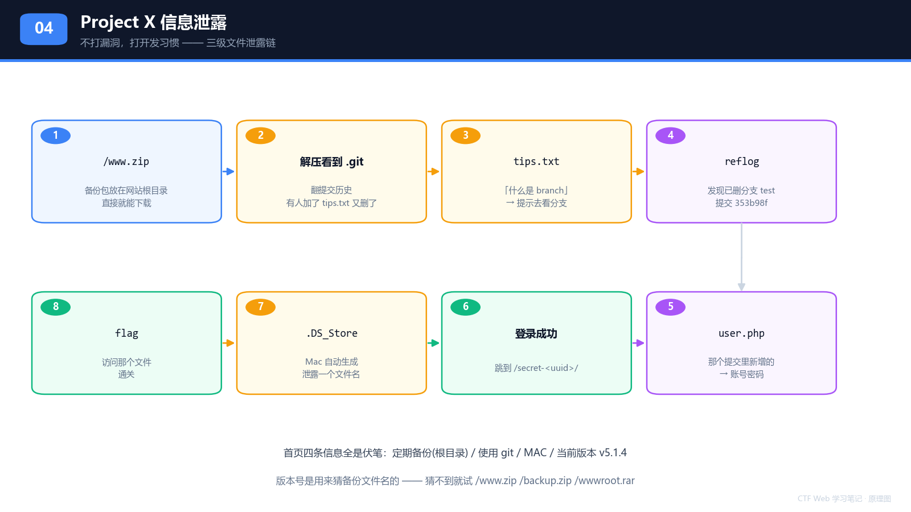
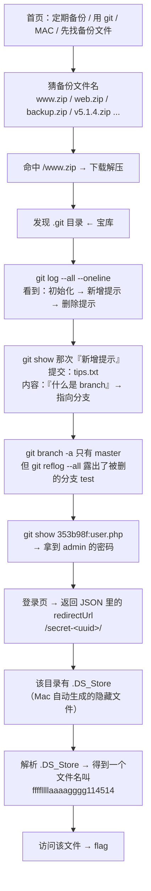

> **CTF Web 学习笔记**（共 19 篇）　[📖 系列总览](/posts/ctf-learning/00-overview/)　·　[← 03 七绝傀儡阵](/posts/ctf-learning/03-qijue-kuileizhen/)　·　[05 eieieieaa →](/posts/ctf-learning/05-eieieieaa/)



> **一句话**：这道题不打漏洞，它打**开发习惯** —— 上线时忘了删的备份包、忘了删的 `.git` 目录、Mac 自动生成的 `.DS_Store`。三样东西，把源码、密码、藏起来的文件名全交代了。

| 项目 | 内容 |
|---|---|
| 类型 | 信息泄露（备份泄露 / 版本库泄露 / 系统隐藏文件泄露） |
| 难度 | ★★★ |
| 前置知识 | 会用 git 看历史、知道网站根目录能放什么 |
| 通关条件 | 备份包 → git 历史 → 密码 → 登录 → `.DS_Store` → 真 flag 文件 |

---

## ① 一眼看懂

首页是一个叫 **PROJECT X** 的产品介绍页，四条信息全是伏笔：

| 首页原文 | 它在暗示什么 |
|---|---|
| 定期备份，并保存在**根目录** | 网站根目录能直接下载到一个备份包 |
| 使用 **git** 进行版本控制 | 备份里带着 `.git`，历史提交能翻 |
| **MAC** 助力提升开发效率 | Mac 会自动生成 `.DS_Store`，泄露文件名 |
| tips：**先找到网站备份文件** | 明示第一步 |
| 当前版本: **v5.1.4** | 版本号，用来猜备份文件名 |

**整条链路**：

```
/www.zip  ←  备份包（直接放在网站根目录，可下载）
   └── 里面有 .git  →  翻历史：有人加了 tips.txt 又删了
          └── tips.txt 说「什么是 branch」→ 提示去看分支
                 └── reflog 里发现被删掉的分支 test，提交 353b98f
                        └── 那个提交里新增了 user.php → 账号密码
                               └── 登录 → 跳到 /secret-<uuid>/
                                      └── 该目录有 .DS_Store → 泄露一个文件名
                                             └── 访问那个文件 → flag
```

---

## ② 思路图



---

## ③ 动手步骤

### 第 1 步：找备份文件

按"备份习惯"猜名字（这就是首页那句 tips 的意思）。实测 **`/www.zip`** 命中：

```
http://<靶机>/www.zip      →  39911 字节，Content-Type: application/zip
```

常用备份名清单（以后自己扫的时候按这个顺序试）：

```
www.zip  web.zip  website.zip  wwwroot.zip  html.zip  public.zip
site.zip  source.zip  code.zip  app.zip  dist.zip  backup.zip  bak.zip
v5.1.4.zip  <项目名>.zip
index.php.bak  index.php~  .index.php.swp  www.tar.gz  www.rar
```

> **注意**：这不是"爆破"，是"猜开发者的习惯"。首页已经把范围缩到一个词：**备份**。
> 真实渗透里对应的是 `dirsearch` / `ffuf` 这类目录扫描工具，配合备份文件名字典。

### 第 2 步：解压，发现有 `.git`

解压后目录长这样：

```
www.zip
├── index.html          ← 首页
├── css/                ← 样式
└── public-555edc76-9621-4997-86b9-01483a50293e/
    ├── .git/           ← ★ 版本库，答案在这里
    ├── index.html      ← 登录页
    └── login.php
```

**`.git` 目录被打包上传了**。这是最经典的源码泄露之一。

### 第 3 步：git 速成（零基础看这里）

把 git 想成**游戏存档系统**：

| 词 | 大白话 |
|---|---|
| **仓库（repository）** | 整个存档库，就是那个 `.git` 目录 |
| **提交（commit）** | 一次存档，有编号（如 `5f8ecc0`）和备注（如"删除提示"） |
| **分支（branch）** | 一条平行世界。别的分支上改的东西，`master` 上看不到 |
| **reflog** | **行动流水账**：你什么时候切分支、提交了什么，全记着 |

**关键认知**：**在 git 里「删掉」通常不等于消失**，这就是本题的核心。（严格说：删文件 = 提交一次「移除」操作，旧版本对象还在；删分支 = 删掉引用，对象暂时还在但可能被垃圾回收。本题能捞出来，是因为这份备份保留了完整对象与本地 reflog。）

```bash
cd public-555edc76-9621-4997-86b9-01483a50293e

# ① 看历史（--all 才能看到所有分支）
git log --all --oneline
#   5fef682 删除提示
#   5f8ecc0 新增提示
#   1389b47 初始化

# ② 看某次提交改了什么
git show 5f8ecc0
#   +tips：什么是branch        ← 加进来的一行

# ③ 直接读某个版本里的某个文件（冒号后面跟文件名）
git show 5f8ecc0:tips.txt
#   tips：什么是branch
```

> 💡 如果 git 报 `detected dubious ownership`（仓库属主与当前用户不一致）：
> **只信任这一个仓库的路径**：`git config --global --add safe.directory "<该仓库的绝对路径>"`
>
> ⚠️ **不要用 `safe.directory "*"`** —— 那等于对所有仓库关闭所有权检查，而你正在分析的恰恰是**来源不可信的下载仓库**。
> 取消信任：`git config --global --unset safe.directory`

### 第 4 步：🎯 找出被删掉的分支

`git branch -a` 只看到一个 `master`，看起来什么都没有。但 **reflog 出卖了它**：

```bash
git reflog --all
# 353b98f HEAD@{3}: commit: 测试，这个branch会删
# 1389b47 HEAD@{4}: checkout: moving from master to test
```

翻译：**曾经有个 `test` 分支，在里面存过一次档（编号 `353b98f`），后来分支被删了。**

删分支只是删掉"名字"，那个存档对象还躺在 `.git/objects/` 里。所以直接按编号捞：

```bash
git show 353b98f              # 看这个孤儿提交改了什么 → 新增了 user.php
git show 353b98f:user.php     # ← 直接读文件内容
```

**预期输出**：

```php
<?php
function getUserData() {
    return [
        'username' => 'admin',
        'password' => 'xxxxxxxx-xxxx-xxxx-xxxx-xxxxxxxxxxxx'   // 36 位 uuid4
    ];
}
```

> **顺便解释登录页那句嘲讽**：「tips: 默认密码使用 uuid4 生成，不可能被爆破」——
> 说得没错，**爆破确实爆不出来**。但它躺在 git 历史里，根本不用爆。

### 第 5 步：登录

登录页在（解压包里那个 `public-<uuid>/index.html`）：

```
http://<靶机>/public-555edc76-9621-4997-86b9-01483a50293e/index.html
```

用 `admin` + 刚才读到的密码提交。**注意**：它的返回不是 302 跳转，而是一段 **JSON**：

```json
{"success": true, "message": "登录成功！正在跳转...", "redirectUrl": "/secret-1c84a90c-.../"}
```

失败时长这样（注意最后那句嘲讽）：

```json
{"success": false, "message": "登录失败,在git里找找吧", "redirectUrl": ""}
```

把 `redirectUrl` 拼到域名后面访问。

### 第 6 步：`.DS_Store` 泄露

打开 `/secret-<uuid>/`，页面只写了一句：

> 恭喜你，离 flag 只差一步了。提示：**小E拿 mac 写的这段代码。这会泄露什么吗？**

**macOS 的坑就是 `.DS_Store`**：用 Finder 打开过的文件夹，Mac **可能**生成一个隐藏文件 `.DS_Store`。它保存的是 Finder 的目录显示元数据，**其中一部分记录会泄露该目录下的文件 / 子目录名**（不一定完整，也可能过时）。开发时忘删就跟着上线了。

`.DS_Store` 是**结构化二进制文件**，不是一份纯文本；其中**记录文件名的字段**使用 **UTF-16 大端**编码，所以直接打开是乱码。

规范做法是用专用解析库遍历它的记录；下面这段正则只是**启发式提取**（够用，但可能漏项或误报）：

```python
import urllib.request, re
data = urllib.request.urlopen("http://<靶机>/secret-<uuid>/.DS_Store").read()
print(re.findall(r"[A-Za-z0-9_\-\.\{\}]{4,}", data.decode("utf-16-be", "ignore")))
# → ['ffffllllaaaagggg114514']
```

> 其他选择：`strings -e b .DS_Store`（GNU strings 的 `-e b` 表示 16 位**大端**，别写成 `-el`）、在线 .DS_Store 解析器、或专门的取证工具。`strings` 只是辅助手段，不是完整解析器。

**得到文件名**：

```
ffffllllaaaagggg114514
```

**注意它是双写的**：`ff ll aa gg` → 读起来就是 **flag**。出题人故意起这种名字，**就是让你猜不到** —— 只有 `.DS_Store` 知道它叫什么。后面 `114514` 呼应首页那句"历时 114514 天开发"。

### 第 7 步：读 flag

```
http://<靶机>/secret-<uuid>/ffffllllaaaagggg114514
```

**预期**：页面直接给出 `flag{...}`。

> 实测 `flag114514`、`flag114514.txt` 这类"正常"名字全是 404 —— 再次说明了 `.DS_Store` 的价值。

---

## ④ 原理拆解

三种泄露指向同一根因：**只要内部文件落在了对外可访问的目录里，服务器就可能把它原样交出去**。

补一句免得误解：这条主要适用于**静态文件**（zip 包、`.git` 里的对象、`.DS_Store` 等）。`.php` 这类**动态脚本**是被解释器执行后返回输出，**不会把源码吐出来** —— 所以「根目录放了什么就能下载什么」只对静态资源成立，实际还受路由、权限和服务端配置影响。

**备份泄露**：开发者图省事，把整站打包成 `www.zip` 留在根目录"定期备份"。服务器不区分"给访客看的页面"和"给自己留的压缩包"，猜中文件名即可整站下载（实测 39911 字节）。泄露的不是某个漏洞，而是全部源码，后续攻击都由此展开。

**git 泄露**：git 是版本控制工具，即记录代码每次改动的"时光机"，全部历史存放在项目的 `.git` 隐藏目录中，整站备份会把它一并送出。关键认知是 **git 里"删除"不等于消失**：`tips.txt` 先加后删，旧内容仍留在历史提交中；`reflog`（引用变更日志，记录分支的每一次变动）还能挖出已被删除的 test 分支，其中 `user.php` 直接写死了登录凭证：

```php
return ['username'=>'admin','password'=>'<36位uuid4>'];
```

凭证一旦进过版本库，删文件并不能抹掉历史 —— 这正是登录页提示「在 git 里找找吧」成立的原因。

> ⚠️ **边界条件**：不可达对象也可能被垃圾回收、reflog 也会过期，而且 `git clone` 默认不会带走 reflog。本题之所以能恢复，是因为**这份备份里保留了完整的 `.git` 对象和本地 reflog** —— 不能保证任何删除历史都能找回。

**.DS_Store 泄露**：macOS 的 Finder（文件管理器）会在打开过的每个文件夹里自动写入 `.DS_Store` 隐藏文件，记录该目录里有哪些文件。开发者用 Mac 写完代码后整目录上传，它被一并带上服务器；即使服务器关闭了目录列表，攻击者解析这个文件（本题按 UTF-16BE 读出伪装文件名 `ffffllllaaaagggg114514`）即可摸清目录内容。其本质是**开发环境自动生成的副产品混进了发布内容**。

---

## ⑤ 延伸与防御

### A. 真实世界对应

本题属于 **OWASP A05:2021 Security Misconfiguration（安全配置错误）**，即服务器或发布流程配置不当，使内部文件可以被外部访问。CWE 是通用弱点分类：对应 **CWE-538：Insertion of Sensitive Information into Externally-Accessible File or Directory（将敏感信息放入外部可访问目录）**；也可归入 **CWE-200：Exposure of Sensitive Information to an Unauthorized Actor（向未授权者暴露敏感信息）**。

公开案例：

- **GitHub 用户，2013 年**：新版代码搜索让公开仓库中误提交的密码、私钥等凭证更容易被检索。问题并非 Git 本身泄密，而是开发者把秘密写进了公开历史。（此案例的时间与细节**需核实**）
- **丰田汽车，2022 年披露**：承包商把含服务器访问密钥的源码公开在 GitHub，持续约五年，导致最多约 29.6 万名 T-Connect 用户的信息可能被访问。

### B. 同类题变形

- **备份改名**：文件可能叫 `site.tar.gz`、`www.zip.bak` 或带日期。结合页面提示、响应头和常见命名判断，不能只尝试一个文件名。
- **禁止访问 `.git/` 首页**：即使返回 403，`.git/HEAD`、对象文件等子路径仍可能单独可读；应分别检查关键文件，而非只看目录入口。
- **秘密已从当前代码删除**：查看提交历史、其他分支和引用记录；Git 删除文件通常不会删除旧对象。
- **没有目录列表**：解析 `.DS_Store` 可恢复部分文件名，再逐个请求验证。
- **文件名编码或伪装**：可能使用 UTF-16BE、重复字符或无扩展名；先按文件格式解析，不要只用文本编辑器肉眼搜索。

### C. 防御写法

错误写法把整个项目直接发布：

```dockerfile
COPY . /var/www/html/
```

这会同时复制 `.git`、备份和 `.DS_Store`。正确做法是只发布经过筛选的产物，并让 Web 根目录只包含公开文件：

```dockerfile
COPY public/ /var/www/html/
```

同时增加兜底规则：

```nginx
location ~ (^|/)\. { deny all; }
location ~* \.(zip|tar|gz|bak|sql)$ { deny all; }
```

筛选发布从源头排除内部文件，拒绝规则则防止误上传后被下载。已经进入 Git 的密码必须立即作废并更换；仅删除文件或提交新版本，旧凭证仍可能存在于历史中。
