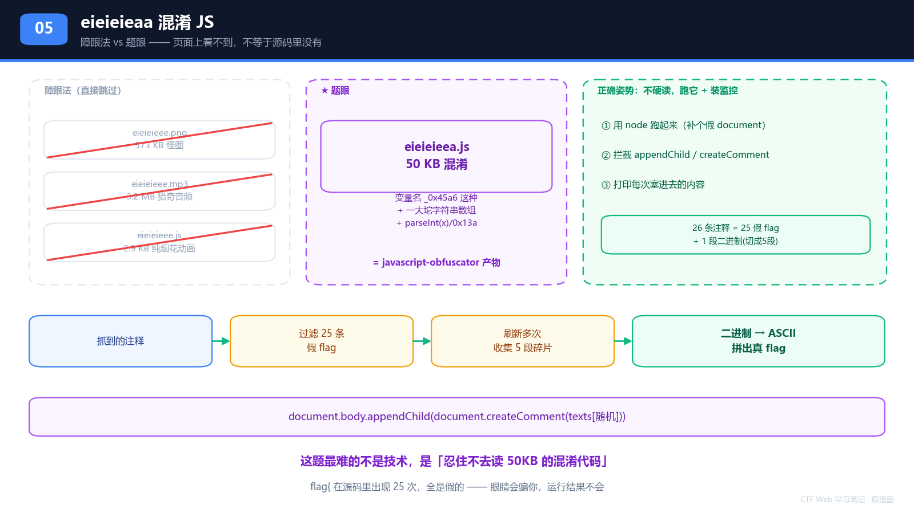
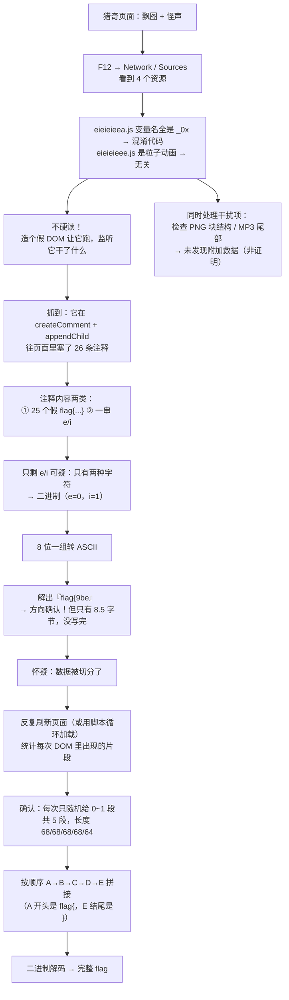

> **CTF Web 学习笔记**（共 19 篇）　[📖 系列总览](/posts/ctf-learning/00-overview/)　·　[← 04 Project X](/posts/ctf-learning/04-projectx/)　·　[06 SQL 注入 →](/posts/ctf-learning/06-sql-injection/)



> **一句话**：页面上的猎奇动画和声音全是障眼法。真正的题在一段**混淆过的 JS** 里 —— 它偷偷往 DOM 里塞了 26 条注释：25 条是**假 flag**，剩下的是被切成 5 段的**二进制**碎片，而且**每次刷新只随机给你一段**。

| 项目 | 内容 |
|---|---|
| 类型 | 前端代码分析 / 反混淆 / 编码解码 |
| 难度 | ★★★★ |
| 前置知识 | 会看 F12 Elements 和 Console、知道二进制和 ASCII、能跑 node 脚本 |
| 关键认知 | **页面上看不到 ≠ 源码里没有**；**`flag{` 出现 25 次全是假的** |

---

## ① 一眼看懂

打开页面：一个飘来飘去的怪图 + 一段猎奇音频。首页源码里加载了四个资源：

```html
<script src="./eieieieea.js"></script>    <!-- 50KB，混淆过的 ★ 题眼 -->
<script src="./eieieieee.js"></script>    <!-- 2.9KB，纯烟花动画，无关 -->
               <!-- 573KB，障眼法 -->
<audio src="./eieieieee.mp3">             <!-- 3.2MB，障眼法 -->
```

**怎么一眼分辨哪个是题眼？**

| 特征 | 判断 |
|---|---|
| 变量名全是 `_0x45a6` 这种 | **obfuscator 混淆过** → 题眼 |
| 一大坨字符串数组 + `parseInt(...)/0x13a` 这种算术 | 典型的 `javascript-obfuscator` 产物 |
| 只画 canvas 粒子动画 | 装饰，跳过 |

**方向**：混淆代码不硬读，**直接跑它，在旁边装监控**。跑起来后你会发现它在做这件事：

```js
// 伪代码，还原后的逻辑
const texts = [ 假flag1, 假flag2, ..., "Here's your flag: " + 二进制串, ... ];
document.body.appendChild(document.createComment(texts[随机]));   // 塞 26 次
```

**三个关键发现**：

1. **注释节点** —— 用 `createComment()` 塞进 `<body>`，**页面上完全不显示**，但 F12 → Elements 里能看到
2. **25 个假 flag** —— `flag{b4d_flag_lol}`、`flag{wr0ng_key007}`、`flag{f4ke_bit123}`…… 名字就是明着嘲讽你
3. **真东西是 `e/i`** —— 一句 `Here's your flag: ` 后面跟着 68 个 `e`/`i`，那是 **flag 的二进制表示**（`e`=0，`i`=1）

**最猎奇的设计**：这段二进制被切成 **5 段**，每次加载页面**只随机丢出 0~1 段**（另外 25 个位置放假 flag）。想集齐必须**反复刷新**。

---

## ② 思路图



---

## ③ 动手步骤

### 第 1 步：扒资源，分清楚谁是谁

把 4 个文件全部下载到本地（离线分析更自由）：

```python
import urllib.request, os
BASE = "http://<靶机>"
for f in ["eieieieea.js", "eieieieee.js", "eieieieee.png", "eieieieee.mp3"]:
    urllib.request.urlretrieve(BASE + "/" + f, f)
```

**判断方法**：`eieieieee.js` 里是 `class _4 { ... }` 画 canvas 粒子的，直接丢掉。
`eieieieea.js` 里第一行就是 `function _0x45a6() { var _0x44ea04 = ['yhsWT', '5|3|4|2', ...` —— **这就是 obfuscator 混淆**。

### 第 2 步：给它造个"假浏览器"，看它到底干了什么

**核心思路**：混淆代码人肉读是自虐，但**代码终究要跑起来**。跑的时候在旁边装摄像头就行。

> ⚠️ **安全前提（务必先看）**：`eval` 一段从网上下载、自己没读过的 JS，等于**以你本机用户的权限运行陌生代码**。伪造 `document` 只是让它「跑得下去」，**这不是沙箱** —— 它照样能读文件、连网络、执行系统命令。请放到**没有敏感文件的虚拟机 / 容器**里跑，跑完删掉。下文 jsdom 的 `runScripts: 'dangerously'` 同理。

```javascript
// run_fake_dom.js
const fs = require('fs');
const code = fs.readFileSync('eieieieea.js', 'utf8');
const captured = [];

function node(t) {
  return new Proxy({ textContent: t, data: t }, {
    set(tg, k, v) {
      if (k === 'textContent') captured.push(v);   // ★ 摄像头
      tg[k] = v; return true;
    },
    get(tg, k) { return tg[k]; }
  });
}

global.document = {
  body: { appendChild: (n) => captured.push('[append] ' + n.textContent) },
  createComment: (t) => node(t),
  createElement: () => node(''),
  getElementById: () => null,
  querySelector: () => null,
  querySelectorAll: () => [],
};
global.window = global;
global.self = global;
global.navigator = { userAgent: 'node' };

eval(code);            // ← 直接跑
console.log(captured);
```

**运行结果**（关键片段）：

```
flag{b4d_data_2025}
Here's your flag: eiieeiieeiieiieeeiieeeeieiieeiiieiiiieiieeiiieeieiieeeieeiieeieieeii
flag{wr0ng_bit_xyz}
flag{fast_bit999}
...
```

**三条信息一次到手**：
1. 它在用 `createComment` 往 DOM 里塞东西
2. 25 个 `flag{...}` 是假货
3. 真货是那句 `Here's your flag: ` 后面的 `e/i`

### 第 3 步：用真浏览器（F12）也能看到

虽然 DOM 一直在动（动画脚本每帧都在改页面），但有三种办法抓：

**方法 A：Console 一行，把注释读成数组**（不用跟它硬刚）

```js
[...document.body.innerHTML.matchAll(/<!--([\s\S]*?)-->/g)].map(m=>m[1]).filter(t=>/^[ei]{32,}$/.test(t.replace(/^Here's your flag:\s*/,''))).join('\n')
```

**方法 B：让页面冻住再看**
F12 → `Ctrl+Shift+P` → 输入 `Disable JavaScript` → 回车。页面立刻冻结，DOM 不再变化，去 Elements 里慢慢翻。（看完执行 `Enable JavaScript` 恢复）

**方法 C：快照复制**
Elements 面板右键 `<body>` → Copy → **Copy outerHTML**，粘到记事本里搜 `eiie`。

### 第 4 步：`e/i` 是什么？先猜再验证

页面名 `eieieieaa`、所有文件名 `eieieie…`，答案用 `e/i` 组成 —— **`e`/`i` 只有两种值 → 二进制**。

```python
s = "eiieeiieeiieiieeeiieeeeieiieeiiieiiiieiieeiiieeieiieeeieeiieeieieeii"
bits = s.replace('e', '0').replace('i', '1')
# 只解完整字节，别把尾部不足 8 位的也强行转成字符
out = ''.join(chr(int(bits[i:i+8], 2))
             for i in range(0, len(bits) - len(bits) % 8, 8))
print(repr(out))
# → 'flag{9be'
```

**解出 `flag{` 开头 = 方向确认。** 但 68 个字符只有 **8.5 字节**，flag 明显没写完 —— **这是「数据被切分」的信号**。（68 位里最后剩 4 位凑不满一个字节，所以解码时要保留余位，等下一段接上再解。）

**验证过程要穷举**（这一步别偷懒）：

| 试法 | 结果 | 判断 |
|---|---|---|
| `e=0, i=1`，8 位一组，从头开始 | `flag{9be` | ✅ 命中 |
| `e=1, i=0`（反过来） | 乱码 | ❌ |
| 7 位一组 | 乱码 | ❌ |
| 从第 1/2/3…位错开 | 乱码 | ❌ |

**只有一种解法能解出人话**，这就是"自验证"。

### 第 5 步：搞清"为什么只有一段"

**刷新页面，再看 DOM** —— 你会发现每次出现的那段都不一样。

用脚本自动统计（真 DOM 更可靠，`npm install jsdom`）：

```javascript
// 存成 check.js，用 node check.js 运行
// （CommonJS 里不能用顶层 await，所以包一层 async）
const { JSDOM } = require('jsdom');

async function main() {
  for (let i = 1; i <= 10; i++) {
  const dom = await JSDOM.fromURL('http://<靶机>/', {runScripts:'dangerously', resources:'usable'});
  await new Promise(r => setTimeout(r, 3000));
  const w = dom.window.document.createTreeWalker(dom.window.document, dom.window.NodeFilter.SHOW_COMMENT);
  const found = []; let n;
    while ((n = w.nextNode())) {
      const t = String(n.data).replace(/^Here's your flag:\s*/, '');   // 先去前缀
      if (/^[ei]{32,}$/.test(t) && !found.includes(t)) found.push(t);
    }
    console.log(`第${i}次刷新: 命中 ${found.length} 段`, found.map(s => s.length));
    dom.window.close();
  }
}

main();
```

**实测输出**（打印的是本次命中的真片段**数量**与**长度**）：

```
第1次刷新: 命中 0 段 []
第2次刷新: 命中 1 段 [ 68 ]
第3次刷新: 命中 1 段 [ 64 ]
...
第9次刷新: 命中 1 段 [ 68 ]
```

把每次命中的片段**累积去重**，我实测到第 9 次刷新才集齐全部 5 段。

> 每次命中**哪一段**是随机的，上面只打印了数量；具体是哪一段，要靠片段长度和内容自己比对。

**结论**：每次加载 ⇒ 26 条注释 ⇒ **25 个假 flag + 随机 0~1 个真片段**。共 5 段，得反复刷。

### 第 6 步：拼起来解码

5 段固定不变，长度分别是 **68 / 68 / 68 / 68 / 64**。顺序怎么定？（下面的方法能快速缩小范围，**但不能保证唯一**，最后要靠格式和提交结果确认）

- **A** 以 `flag{9be` 开头 → 一定是第一段
- **E** 以 `bf3cd3d}` 结尾 → 一定是最后一段
- 中间的 **B/C/D** 用"错位就乱码"来试（5 段全排列才 120 种，暴力最快）

```python
import itertools
def decode(s):
    bits = s.replace('e','0').replace('i','1')
    b = bits[:len(bits)//8*8]
    return ''.join(chr(int(b[i:i+8],2)) for i in range(0,len(b),8))

for p in itertools.permutations(parts):          # parts = 收集到的 5 段
    t = decode(''.join(p))
    if t.startswith('flag{') and t.endswith('}'):
        print(t)
```

**结果**：

```
flag{9be08918-c129-4df5-beac-34496bf3cd3d}
```

标准 UUID 格式（8-4-4-4-12），完美闭合。

> ⚠️ **别把「能解出可读文本」当成唯一性证明 —— 我实测过，它不是唯一的。**
> 用 `startswith('flag{') and endswith('}')` 这个粗糙条件筛，**5 段的全排列里有 6 种都能通过**；其中 `A→D→C→B→E` 拼出来是 `flag{9be5ac-344969-4df5-b`8918-c12bf3cd3d}` —— 全是可打印字符，但**不是合法 UUID**（分隔符位置不对，还混进了一个反引号）。
> 真正区分开的是**格式**：正确答案严格符合 `8-4-4-4-12` 的 UUID 结构。**最后以平台提交结果为准**，别只靠「看着像」。

### 第 7 步：排除干扰（我替你验过了）

| 检查项 | 结论 |
|---|---|
| PNG 块结构 | 只有 IHDR / 17 个 IDAT / IEND，**IEND 之后没有附加数据** |
| PNG 全文搜 `flag{` | 无 |
| MP3 尾部 32 字节 | 全 0，无可读字符串 |
| MP3 全文搜 `flag{` | 无 |

在这些检查下**没有发现隐写痕迹**，而 JS 那条线索已经给出了可验证的完整答案，所以**可以不必再深挖这两个文件**。

> 严谨一点：「没找到」不等于「没有」。像素 LSB、音频频谱、合法数据块内部都可能藏数据。说它们「纯属障眼法」是基于当前证据的判断，不是证明。

---

## ④ 原理拆解

**为什么混淆挡不住这题。** 混淆是把代码故意改得难读、但功能不变的加工。本题用的 javascript-obfuscator 会把变量名统一替换成 `_0x45a6` 这类乱码，50KB 代码人眼几乎没法读。但代码再丑浏览器照样执行：混淆只抬高了「读」的成本，改不了「跑」的行为，所以不必读懂它，在浏览器外模拟跑一遍、观察它做了什么即可。

**为什么答案藏在注释里。** HTML 注释是存在于页面结构里、但浏览器不显示出来的内容，正常浏览永远看不见，是天然的藏匿点。被捕获的行为就是反复创建注释节点塞进 body：

⚠️ 示意代码，非本题源码
```js
const c = document.createComment("flag{b4d_flag_lol}");
document.body.appendChild(c); // 挂进页面结构，但页面不显示
```

**为什么 26 条里 25 条是假的。** 每次加载随机只出现 0~1 条真片段（共 5 段），其余都是 `flag{wr0ng_key007}` 这类诱饵，专门惩罚「开 F12 抄走第一个像 flag 的字符串」的做法——真答案必须多次刷新、集齐 5 段才存在。

**为什么用 e/i 编码。** e 代表 0、i 代表 1，每 8 位按 ASCII（数字与字符的对照表）转一个字符。关键在每段 68 位不是 8 的整数倍，单独一段切不出完整字节，必须拼接；而 5 段共 68×4+64=336 位，恰等于 42 字符 ×8 位，与 flag 长度严丝合缝。顺序错了只会得到乱码而非「半个答案」，所以「读起来通顺」本身就是校验器，顺序因此能被试出来。

**为什么可以先放下 PNG/MP3。** PNG 以 IEND 块作为文件结束标记，本题 IEND 后无附加数据；MP3 尾部全 0，全文也搜不到 `flag{`。

这些只能说明**没发现明显的附加数据**，**不等于证明了不存在隐写**（像素 LSB、音频频谱、合法块内部都可能藏数据）。但因为 JS 线索已经给出可验证的完整答案，继续深挖这两个大文件的性价比很低。

---

## ⑤ 延伸与防御

### A. 真实世界对应

本题对应"把秘密交给浏览器，再试图藏起来"的设计问题，可归入 **A04:2021 Insecure Design（不安全设计）**。OWASP Top 10 是常见 Web 安全风险分类，不是每种题型都有唯一归属；这里不是注入漏洞。

对应 **CWE-540: Inclusion of Sensitive Information in Source Code（源代码包含敏感信息）**；注释藏密还对应 **CWE-615: Inclusion of Sensitive Information in Source Code Comments（源代码注释包含敏感信息）**。CWE 是软件弱点的编号目录。

真实案例：2021 年，美国密苏里州教育部门网站将教师社会安全号码包含在页面源码中，《圣路易斯邮报》记者发现并报告。它与本题的共同点是：页面不显示，不代表浏览器没收到。参见[事件报道](https://www.itnews.com.au/news/us-governor-accuses-source-code-viewing-site-visitor-of-hacking-571312)。

### B. 同类题变形

- **换字符表**：e/i 改成空格、制表符；保留原始字符，测试两种映射，别先清理空白。
- **换存放位置**：注释改成元素属性或接口响应；追踪数据最终写到哪里，不只搜索注释。
- **出现后立即删除**：最终页面看不到片段；记录节点创建、修改时的内容，而非只看最后状态。
- **片段重复或缺失**：先去重、记录长度，再检查总位数与格式；可读性只是线索，不能单独证明顺序正确。

### C. 防御写法

以下是示意代码，非本题源码。错误写法仍把答案发送给所有访问者：

```js
// 浏览器端：编码不能保密
const secret = decode(encodedFlag);
document.body.appendChild(document.createComment(secret));
```

正确方向是只在服务端校验，前端文件不包含答案及其可逆编码：

```js
// 服务端路由内部；答案由服务器环境变量提供
const ok = req.body.answer === process.env.CTF_FLAG;
res.json({ ok });
```

服务端是由网站运营者控制、不会随页面下载的程序运行环境。前端只提交学员答案，服务器只返回对错；正式接口还应限制提交频率，避免反复猜测。更换编码、增加假答案或加强混淆，都不能替代这个边界。
