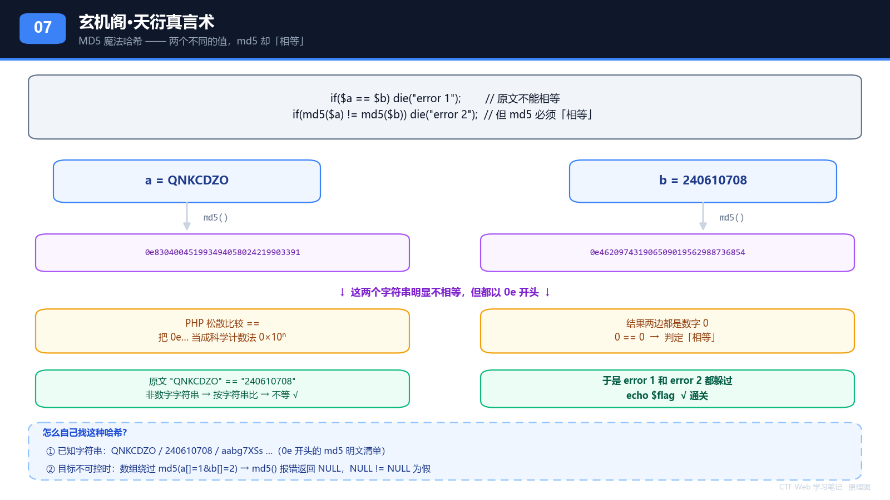
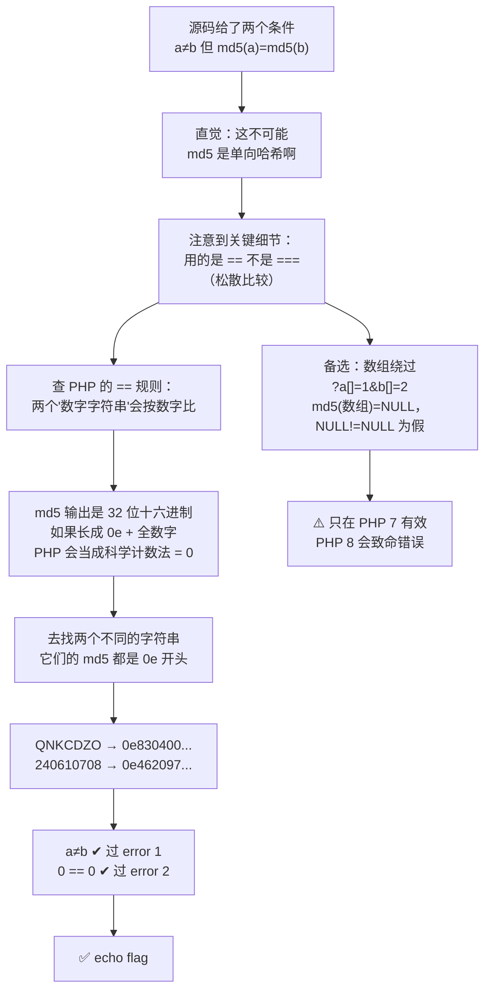

> **CTF Web 学习笔记**（共 19 篇）　[📖 系列总览](/posts/ctf-learning/00-overview/)　·　[← 06 SQL 注入](/posts/ctf-learning/06-sql-injection/)　·　[08 路径穿越 →](/posts/ctf-learning/08-path-traversal/)



> **一句话**：题目要求「a 和 b 不能相等，但它们的 md5 必须相等」。正常思维下这是不可能的 —— 但 PHP 的**松散比较 `==`** 会把长得像"科学计数法"的字符串当成**数字 0**，于是两个完全不同的 md5 也被判成相等。

| 项目 | 内容 |
|---|---|
| 类型 | PHP 类型戏法 / Hash 比较绕过 |
| 难度 | ★★ |
| 入口 | `GET /?a=xxx&b=xxx` |
| 关键 payload | `?a=QNKCDZO&b=240610708` |
| 考点 | `==` 与 `===` 的区别、字符串转数字规则 |

---

## ① 一眼看懂

题目把源码直接给你了（`highlight_file(__FILE__)`）：

```php
<?php
highlight_file(__FILE__);
$flag = getenv('FLAG');

$a = $_GET["a"] ?? "";
$b = $_GET["b"] ?? "";

if($a == $b){
    die("error 1");
}

if(md5($a) != md5($b)){
    die("error 2");
}

echo $flag;
```

**翻译成人话**：

| 代码 | 要求 |
|---|---|
| `if($a == $b) die("error 1")` | a 和 b **不能**"松散相等" |
| `if(md5($a) != md5($b)) die("error 2")` | 但它们的 md5 **必须**"松散相等" |

**你看到 `error 1`，说明你传的 a 和 b 被判成了"相等"。**

> 💡 **顺带一个新手必踩的坑**：如果你**什么参数都不传**直接打开页面，`$a` 和 `$b` 都是空字符串 `""`，`"" == ""` 成立 → 立刻 `error 1`。
> 所以"error 1"不一定是你 payload 错了，可能只是你还没传参数。

### 破题的关键只有一个词：`==`

| 写法 | 名字 | 行为 |
|---|---|---|
| `==` | **松散比较** | PHP 会**猜类型**：能当数字就当数字比 |
| `===` | **严格比较** | 类型和值都必须一模一样 |

题目用的是 `==` —— 这就是全部漏洞。

---

## ② 思路图



---

## ③ 动手步骤

### 第 1 步：先看清自己在哪一步挂的

| 回显 | 含义 |
|---|---|
| `error 1` | `$a == $b` 成立了 → 你传的两个值被判成相等（或你没传参数） |
| `error 2` | `$a == $b` 过了，但 `md5($a) != md5($b)` 成立 → 你想让 md5 相等但这俩哈希确实不同 |
| `flag{...}` | 成功 |

### 第 2 步：直接用魔法哈希（推荐）

```
?a=QNKCDZO&b=240610708
```

**完整 URL**（把 `<靶机>` 换成实际地址）：

```
http://<靶机>/?a=QNKCDZO&b=240610708
```

**预期结果**：页面直接输出 `flag{...}`。

> 👉 这两个值的 md5 **我已在本机用 Python 独立验证**（md5 算法与语言无关）：
>
> | 值 | md5 |
> |---|---|
> | `QNKCDZO` | `0e830400451993494058024219903391` |
> | `240610708` | `0e462097431906509019562988736854` |
>
> 两个字符串本身不同 ✔，两个 md5 本身也不同，但**都是 `0e` + 纯数字** ✔

### 第 3 步（备选）：数组绕过

```
?a[]=1&b[]=2
```

**原理**：把数组喂给 `md5()` 会失败并返回 `NULL`，于是 `NULL != NULL` 为假 → 过 error 2；
而 `[1] == [2]` 为假 → 过 error 1。

**⚠️ 版本限制（重要）**：

| PHP 版本 | `md5([])` 的结果 | 数组绕过能用吗 |
|---|---|---|
| PHP 5.x / 7.x | 返回 `NULL` + 一条 Warning | ✅ 能用 |
| PHP 8.0+ | **TypeError 致命错误** | ❌ 不能用（页面直接 500） |

**所以优先试第 2 步的魔法哈希** —— 它在 PHP 7 和 PHP 8 上都成立（原因见 ④）。

### ⚠️ 三个常见翻车点

| 现象 | 原因 |
|---|---|
| 报 `error 1` | 两个值被判成相等；或者**你根本没传参数**（空字符串之间相等） |
| 报 `error 2` | 你选的两个值 md5 不是 `0e` 开头（比如抄错了一个字符） |
| 用数组绕过页面 500 | 靶机是 PHP 8，数组那招无效，改用魔法哈希 |

---

## ④ 原理拆解

### 为什么 `0e123...` 会等于 `0e456...`？

PHP 在做 `==` 时，有一条规则：**如果两个字符串"看起来都是数字"，就先把它们转成数字再比**。

而 `0e830400451993494058024219903391` 这种形式，在数学上是 **科学计数法**：

```
0e830400...   =   0 × 10^830400...   =   0
0e462097...   =   0 × 10^462097...   =   0
```

所以 PHP 眼里：`0 == 0` → **相等**。

**注意**：这两个 md5 **字符串本身并不相同**（`===` 会判为不等），只有在 `==` 下才会被判成相等 —— 这正是本题的题眼。

### 为什么这两个值的 md5 长得这么巧？

不是巧合，是**暴力搜出来的**。字符串可以是任意内容，全世界已经有一批现成的"魔法哈希"（见附录 A），直接拿去用就行，不需要自己算。

### 为什么 PHP 8 也照样能过？

这是很多文章写错的地方，这里说清楚：

PHP 8.0 确实改过字符串比较规则（RFC：*Saner string to number comparisons*），但改的是**"数字 vs 非数字字符串"**：

| 比较 | PHP 7 | PHP 8 |
|---|---|---|
| `0 == "foo"` | `true`（把 "foo" 转成 0） | **`false`**（改成按字符串比） |
| `"0e123" == "0e456"` | `true` | **`true`（没变）** |

因为 `"0e123"` 和 `"0e456"` **两个都是合法的数字字符串**，PHP 8 依然按数字比较 → 都是 0 → 相等。

> ⚠️ **依据说明**：以上 PHP 版本行为依据 PHP 官方 RFC 与文档描述整理。本机没有 PHP 运行环境（Docker 守护进程也未启动），**未能在本题靶机上实测**。请以实际回显为准。

### 数组绕过的原理

```php
md5([1])   // PHP 7: Warning + 返回 NULL
md5([2])   // 同样 NULL
NULL != NULL   // false → 不 die，过 error 2
[1] == [2]     // false → 不 die，过 error 1
```

PHP 8 之后函数参数类型变严格，`md5()` 收到数组直接抛 `TypeError`，这条路就断了。

---

## ⑤ 延伸与防御

### A. 真实世界对应

属于 **OWASP Top 10 A03:2021 Injection** 的大类下（**输入未按预期类型处理**），更精确地对应：

- **CWE-843：Type Confusion（类型混淆）**
- **CWE-697：Incorrect Comparison（比较方式不正确）**

**真实教训**：
- **2004 年，王小云团队公布 MD5 碰撞攻击** —— 从那时起 MD5 就不再适合做完整性校验和签名。2012 年的 **Flame 恶意软件**就利用 MD5 碰撞伪造了微软的数字签名，这是真实世界最著名的战例之一。
- **PHP 的类型戏法**在真实漏洞里屡见不鲜：很多"哈希比对"（比如校验授权码、比对 token）因为用了 `==` 而被绕过。2016 年前后大量 PHP 应用被爆出"`0e` 开头哈希绕过"。

（以上为公开资料的概述，具体细节以官方公告／论文为准。）

### B. 同类题变形

| 变形 | 应对思路 |
|---|---|
| 改成 `md5($a) === md5($b)`（严格） | **魔法哈希失效**，只能用**真实的 MD5 碰撞样本**（两个不同的二进制串，md5 完全相同，网上有现成的 urlencoded 版） |
| 改成 `sha1` / `hash('sha256')` 等 | 同理找该算法的 `0e` 开头输出（sha1 也有魔法值，如 `aaroZmOk`） |
| 用 `strcmp()` 比较 | 传数组：`?a[]=1` → `strcmp` 收到数组返回 NULL（PHP 7）→ 绕过 |
| 用 `in_array()` / `array_search()` 松散比较 | 类型戏法（`0 == "任意字符串"`） |
| 要传**原始二进制**（碰撞样本） | 必须 **URL 编码**（`%4d%c9%68...`），不能直接粘 |
| 校验放在 JSON body 里 | 注意 JSON 会把 `1` 解析成数字、`"1"` 解析成字符串，类型戏法的入口变了 |
| 两个参数名不同（如 `a`/`b` 变成 `user`/`pass`） | 先看源码确认参数名，别照抄 |

### C. 防御写法

❌ **错误写法**

```php
if ($a == $b) { ... }                       // 松散比较，类型戏法的温床
if (md5($a) == md5($b)) { ... }             // md5 本身也早已不该用
if ($user_input == md5($secret)) { ... }    // 真实漏洞里最常见的一行
```

✅ **正确写法**

```php
// 1) 比较一律用严格比较
if ($a === $b) { ... }

// 2) 比较敏感值用 hash_equals（常量时间，还能防时序攻击）
if (hash_equals($expected_hash, md5($a))) { ... }

// 3) 存密码不要用 md5/sha1，用 password_hash（bcrypt/argon2）
$hash = password_hash($password, PASSWORD_DEFAULT);
if (password_verify($password, $hash)) { ... }

// 4) 校验参数类型（别让数组悄悄混进来）
if (!is_string($_GET['a']) || !is_string($_GET['b'])) { die('bad type'); }
```

**三条要点**：

1. `==` 和 `===` **不是风格问题，是安全问题** —— 只要涉及比较，先问自己"这里会不会被类型戏法绕过"
2. **MD5/SHA1 已经不适合任何安全用途**（存密码、签名、完整性校验都不行）
3. **`md5(x) == md5(y)` 永远是坏代码**，见到就该警觉

---

## 附录 A：魔法哈希速查表（本机 Python 独立验证）

以下字符串的 md5 **都是 `0e` 开头且后面全是数字**，两两之间都能互相凑成 payload：

| 字符串 | md5 |
|---|---|
| `QNKCDZO` | `0e830400451993494058024219903391` |
| `240610708` | `0e462097431906509019562988736854` |
| `aabg7XSs` | `0e087386482136013740957780965295` |
| `aabC9RqS` | `0e041022518165728065344349536299` |
| `s878926199a` | `0e545993274517709034328855841020` |
| `s155964671a` | `0e342768416822451524974117254469` |
| `s214587387a` | `0e848240448830537924465865611904` |
| `s1091221200a` | `0e940624217856561557816327384675` |
| `s1885207154a` | `0e509367213418206700842008763514` |
| `s1836677006a` | `0e481036490867661113260034900752` |
| `s1184209335a` | `0e072485820392773389523109082030` |
| `s1502113478a` | `0e861580163291561247404381396064` |
| `s532378020a` | `0e220463095855511507588041205815` |
| `0e215962017` | `0e291242476940776845150308577824` |

**用法**：任选两个不同的填进去 → `?a=QNKCDZO&b=240610708`

**自己验证**（Python，几行就够）：

```python
import hashlib
for s in ["QNKCDZO", "240610708"]:
    h = hashlib.md5(s.encode()).hexdigest()
    print(s, h, "是魔法哈希" if h[:2] == "0e" and h[2:].isdigit() else "不是")
```

## 附录 B：这题学到的 3 个通用招式

| 招 | 一句话 |
|---|---|
| **看 `==` 还是 `===`** | 见到松散比较就想到类型戏法 |
| **`0e` 开头 = 数字 0** | 任何 `0e` + 全数字的哈希，在 `==` 下都等于 0 |
| **md5(数组) = NULL** | PHP 7 的万能绕过；PHP 8 失效，别死磕 |

## 附录 C：踩坑对照表

| 现象 | 原因 | 修法 |
|---|---|---|
| `error 1` | 两个值被判相等，或压根没传参数 | 检查是否真的传了 a 和 b，且两个值不同 |
| `error 2` | 选的魔法哈希抄错了，md5 不是 `0e` 开头 | 从附录 A 直接复制，别手打 |
| 数组绕过页面 500 | 靶机是 PHP 8 | 改用魔法哈希 |
| 改了参数名就失效 | 参数名不像 `a`/`b` | 以源码里的 `$_GET["x"]` 为准 |
