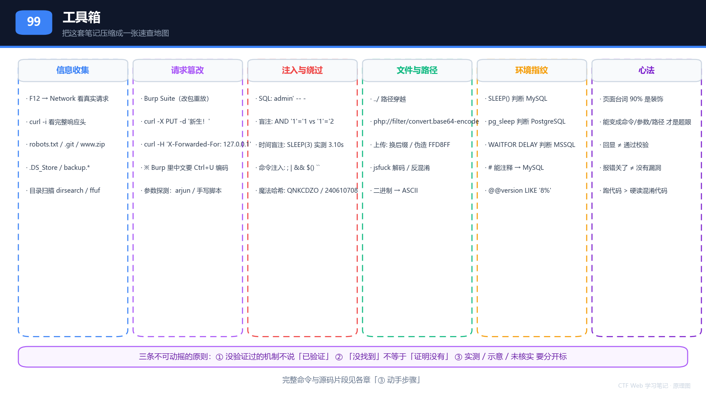

> **CTF Web 学习笔记**（共 19 篇）　[📖 系列总览](/posts/ctf-learning/00-overview/)　·　[← 11 SSTI](/posts/ctf-learning/11-ssti/)　·　[99-1 浏览器与 Burp →](/posts/ctf-learning/99-1-browser-burp/)



> 这一套是「查表用」的：忘了命令就翻这里。为了方便查阅，原来的单篇已拆成 6 个子页（见下表）。
>
> **标注说明**：这里的命令分三类 —— ① 我在靶机上**实际跑过并贴了回显**的；② 从真实源码 / 行为**推断**出来的（会标「示意」）；③ 语法正确但我**没能现场验证**的（会标「未核实」）。请按标注取用。

---

## 本工具箱已拆成 6 个子页

| 子页 | 内容 | 对应原小节 |
|---|---|---|
| **99-1 浏览器与 Burp** | F12 开发者工具、Burp 改包、中文编码的坑 | 一、二 |
| **99-2 命令行与脚本** | `curl.exe`、Python 请求模板、Node/jsdom 跑混淆代码 | 三、四、五 |
| **99-3 git 速查** | 翻历史、`reflog` 找被删分支、`safe.directory` | 六 |
| **99-4 编码与魔法哈希** | URL / Base64 / UTF-16 / 二进制互转、`0e` 魔法哈希表 | 七 |
| **99-5 上传绕过速查** | 文件上传「三张牌」+ 三条硬规矩 | 七 |
| **99-6 真实报错对照表** | 踩过的报错 → 真正原因 → 修法 | 八 |

---

## 九、排查口诀（贴在手边）

```
请求发出去没反应 →
  ① 看状态码   404 路径错 / 405 方法错 / 400 内容错 / 500 看报错
  ② 看回显     回显默认值 = 你的输入没被读到（格式/编码问题）
  ③ 查格式      JSON？表单？裸文本？Content-Length 对不对？中文被吃了吗？
  ④ 最后才怀疑 payload 本身
```

---

## 十、已有笔记索引（本地工作区 `D:\ctf`）

这些是自己之前攒的，和本套笔记配套看：

| 文件 | 内容 |
|---|---|
| `SQL注入模板速查表.md` | SQL 注入：8 个关键字 + 6 套模板 + 判断决策树 |
| `PHP-CTF生存手册.md` | 不学 PHP 语法，只认 20 个危险函数 |
| `SSRF学习笔记-pikachu.md` | SSRF 原理 + pikachu 靶场 `vul/ssrf` 通关 |
| `xss-lab/` | 自建 XSS 靶场（vuln.html / safe.html / level13-demo / payload 工具） |
| `dvwa_raw/` | DVWA 全套页面存档（可用作"去哪自己练"的对照） |
| `readflag-writeup.md` | Pwn：ret2text 栈溢出完整 writeup |
| `40104_writeup.md` | 内部管理系统 v2.0 题解（信息收集 → 利用） |

### 去哪自己练（对照表）

| 本套笔记的漏洞 | 对应可练环境 |
|---|---|
| 01 参数篡改 / 越权 | DVWA `Weak Session IDs`、pikachu 越权模块 |
| 02 命令注入 | DVWA `Command Injection`、pikachu `exec` |
| 03 请求伪造（Cookie/Referer/XFF） | DVWA `Weak Session IDs`、Burp 官方实验 "Referer-based access control" |
| 04 信息泄露 | 自己搭个带 `.git` 的仓库试试 `git reflog` |
| 05 前端混淆 / 编码 | 任意 JS 混淆站（obfuscator.io）+ 本篇的解码代码 |
| 06 SQL 注入 | DVWA `SQL Injection` / `SQL Injection (Blind)`、pikachu SQL 注入模块 |
| 07 魔法哈希 | 自己写个 `md5($a) == md5($b)` 的 PHP 页面，用 `0e` 开头的字符串试 |
| 08 路径穿越 | DVWA `File Inclusion`、pikachu 文件包含 |
| 09 参数枚举 / 只挡前门 | PortSwigger「Access control」专题；重点是**直接访问后端接口绕过前端门禁** |
| 10 文件上传绕过 | DVWA `File Upload`、upload-labs（1~20 关） |
| **11 服务端模板注入（SSTI）** | PortSwigger Web Security Academy 的 **Server-side template injection** 专题（入口见 00 总览的延伸阅读）；本地可搭任意 Express + EJS 的最小 demo |
